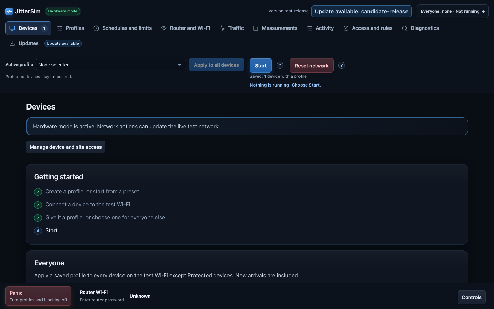
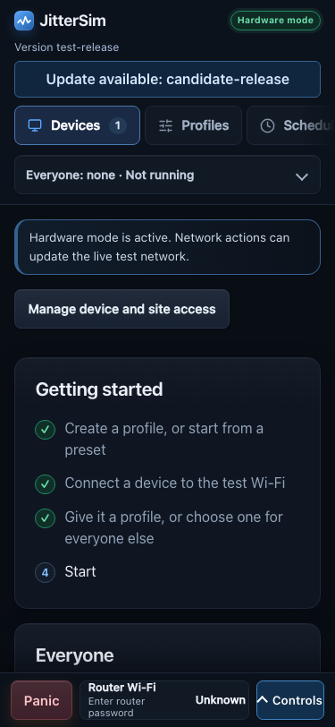
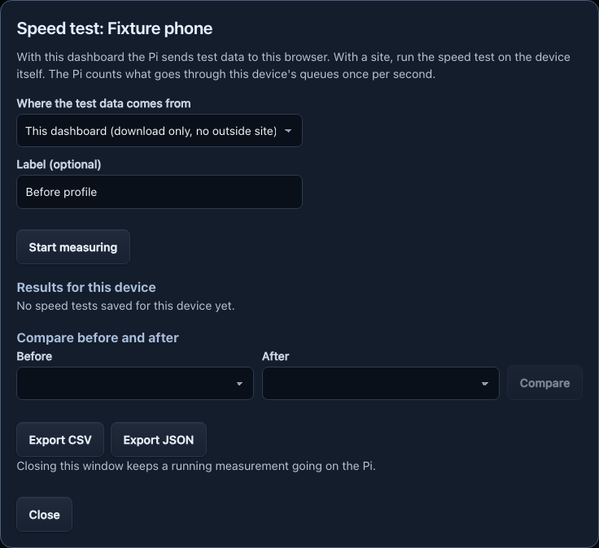
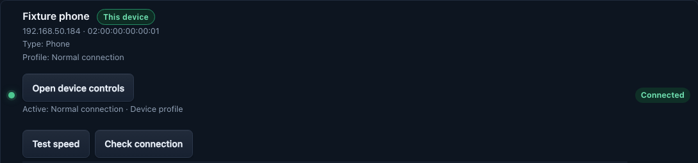
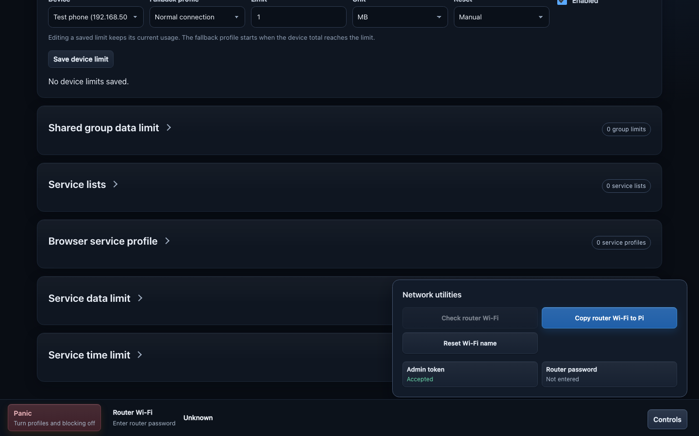
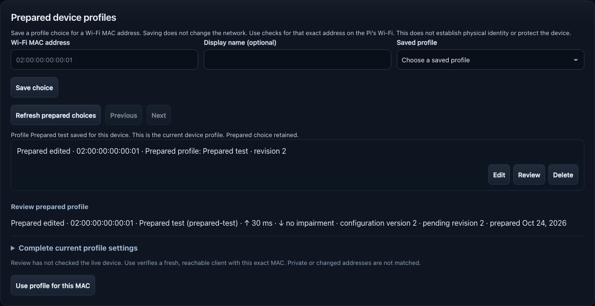

# JitterSim

JitterSim helps you test how a phone or laptop behaves when its internet
connection is slow or unreliable. A Raspberry Pi creates a separate test
Wi-Fi so experiments do not change your regular home Wi-Fi.

Use JitterSim only on equipment and networks you own or have permission to
test. It is for experiments, not a replacement for your home router.

## What you can try

- Slow, delay or interrupt a test connection.
- Start a profile from a preset such as DSL, Slow 3G or Satellite. Each says what its numbers are based on.
- Save different settings for one device or the whole test Wi-Fi, and start a
  single device on its own profile.
- Schedule changes, run a timer or gradually switch between settings.
- Control device, website and service access, with data and time limits. The
  global block list holds up to 2000 names.
- Protect a device from every profile. A protected device opens the dashboard
  with the admin token alone and can have ads blocked.
- Review connected devices and traffic while a test runs. The device you browse
  with over the test Wi-Fi is marked **This device**. Measure a device's speed
  before and after a profile (download from the dashboard itself, with no outside
  server), or check its packet loss, delay and jitter against the profile.
- Follow a saved device to its new private Wi-Fi address, with Ask, Automatic and Undo.
- Choose whether active profiles resume after a router outage.
- Restore the Pi's test Wi-Fi to its default name under **Controls** or on **Router and Wi-Fi**. The page names the network to join again.
- Update the Pi in one step from the dashboard or a terminal with a signed
  release, a recovery copy and an automatic health check.
- Save a copy of the Pi's settings database on your Mac with `jittersim backup pull`.

## Screenshots

  
  

Use the page links across the top to move between tasks. **Panic**, read-only
router Wi-Fi status and **Controls** stay at the bottom of every page. Open
**Controls** for network utilities, including **Reset Wi-Fi name**.

The Address changes card lets you review a saved device's new private Wi-Fi
address before moving its settings. The speed-test window lets you choose a
site and test length before starting a test on the device. On the device itself
the dashboard can send the test data, with no outside site. The device you browse
with is marked **This device**.

  
  
  
  
  

**Prepared device profiles** saves a profile choice for a manually entered Wi-Fi
MAC without changing the network. **Review** shows the current profile settings
and revisions; **Use profile for this MAC** is a separate confirmed action that
checks for a fresh same-address client on the Pi’s test Wi-Fi.

*Screenshots use synthetic sample data and test-release labels; no real phone,
Pi or home network is shown. They are not physical network acceptance evidence.*

## Get started on a Raspberry Pi

Use Raspberry Pi OS with NetworkManager 1.50 or newer, Ethernet connected to
your router and a Wi-Fi radio that supports access-point mode. Create a
`jittersim` account with Raspberry Pi Imager. See the
[Pi deployment guide](deploy/raspberry-pi/README.md#install-or-update) for
signed-release installation, network checks and recovery instructions.

After installation, verify the SHA-256 fingerprint printed by the installer
before trusting the dashboard certificate. Then open
`https://netlab.local:8080` or an IP address covered by the certificate. The
generated admin token is on the Pi in `/etc/jittersim/control.env`.

## Update the Pi

Open **Updates** on the dashboard, choose **Check for updates** and then the
install button, which names the new release. Or run `sudo jittersim update` on
the Pi, or `jittersim remote update now` from a Mac. Each one installs only a
release signed by a key the Pi trusts, keeps a recovery copy and restores it
when the health check fails. The Pi needs a read-only GitHub token once
(`sudo jittersim update set-token`) before it can look for releases. See
[Update the Pi](docs/user-guide.md#update-the-pi) and
[Signed releases](deploy/raspberry-pi/README.md#signed-releases).

## More information

The [feature and operations guide](docs/user-guide.md) explains the dashboard,
network behavior, [known limits](docs/user-guide.md#known-limits) and local
developer setup. See the [changelog](CHANGELOG.md) for what changed, the
[release guide](docs/releases/README.md) for publishing a release, the
[roadmap](ROADMAP.md) for future work, and the
[documentation index](docs/README.md) for the rest of the guides.
