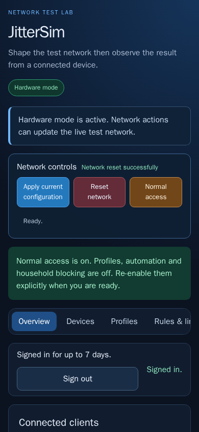
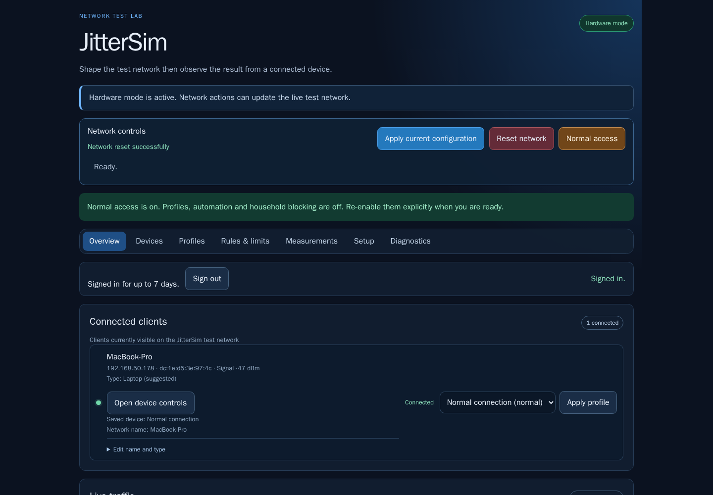

# JitterSim

JitterSim uses a Raspberry Pi to test how apps behave on a slow or unreliable
network. Connect the Pi to your router by Ethernet. Test devices use a
separate Wi-Fi network where you can change delay, jitter, packet loss and
speed.

Use JitterSim only on equipment and networks that you own or have permission
to test. It is a test network, not a replacement for your home router.

<div align="center">
  
  
</div>

*Phone and desktop previews use test data. They show the dashboard, not a live Pi.*

## What you can do

- Shape upload and download traffic with delay, jitter, packet loss, speed
  limits, reordering and short outages.
- Assign profiles to devices. Use groups, schedules, timers, scenarios or
  progressions to change profiles over time.
- Block devices by Wi-Fi MAC address and block named sites or services for a
  device, a group or everyone on the test Wi-Fi.
- Set device, group and service data limits. Review traffic graphs and
  measurements in the dashboard.
- Use the browser proxy to apply different profiles to selected HTTPS sites.

The **Normal access** button stops profiles and automatic changes, turns off
MAC and site blocking and keeps saved settings. The Wi-Fi stays up for ordinary
internet access. The management firewall and isolation between test Wi-Fi
clients stay enabled. **Reset network** stops experiment effects while keeping
household access rules on. Run `sudo jittersim normal-access` over SSH if the
dashboard is unavailable.

Site rules include subdomains. They cannot prevent every VPN, encrypted DNS
connection, direct IP request or other internet connection. Existing
connections or cached DNS answers may outlive a rule change. Site blocking is
not guaranteed parental protection. MAC filtering blocks traffic after a
device joins. Refusing Wi-Fi joins needs a supported access point and Pi
hardware testing.

## Set up the Pi

1. Connect the Pi to your router by Ethernet and keep the router's Wi-Fi
   available as a recovery path.
2. Use Raspberry Pi OS with NetworkManager 1.50 or newer. Set the correct
   wireless country for the Pi before starting its access point.
3. From the project folder run:

   ```sh
   sudo deploy/raspberry-pi/install.sh
   ```

4. Open `https://<pi-name>.local:8080` or use the Pi's Ethernet address.
   Check the certificate fingerprint printed by the installer before trusting
   it in your browser.
5. Sign in with the admin token. On the Pi, run
   `sudo grep JITTERSIM_ADMIN_TOKEN /etc/jittersim/control.env` to read it.
   Do not expose the dashboard or SSH to the public internet.

The installer preserves your saved Wi-Fi name and password. When upgrading
from an older release, use the installer so it can add the new system
services. A code-only update does not install them.

The test Wi-Fi is separate from your home network. Its clients cannot reach
the router's private network and cannot reach each other. Printing, casting or
other local services may not work through it. Test on the Pi and keep the
router's Wi-Fi available before moving devices. See the [Pi installation,
recovery and household trial guide](deploy/raspberry-pi/README.md).

## Run locally

Local mode saves settings and builds plans without changing network traffic.

```sh
python3 -m venv .venv
.venv/bin/pip install '.[dev]'
export JITTERSIM_ADMIN_TOKEN='use-a-long-local-token'
PYTHONPATH=src .venv/bin/python -m jittersim.api --database ./jittersim.db
```

Open <http://127.0.0.1:8080/>. For Tailscale access, updates and Pi recovery,
see the [deployment guide](deploy/raspberry-pi/README.md).

## Run checks

Run the Python tests with:

```sh
PYTHONPATH=src .venv/bin/python -m unittest discover -s tests
```

The Linux network checks use real firewall and traffic-control rules in
disposable network namespaces. Run them in a privileged Linux container with:

```sh
tests/kernel/run-in-docker.sh
```

The browser checks exercise the dashboard on desktop and phone-sized screens.
GitHub Actions runs the Python, Linux and browser checks for each pull
request.

## More information

- [Pi installation, security, recovery and hardware testing](deploy/raspberry-pi/README.md)
- [Measured effects of the profile presets](docs/measurements-2026-09.md)
- [Product roadmap and known limits](ROADMAP.md)
