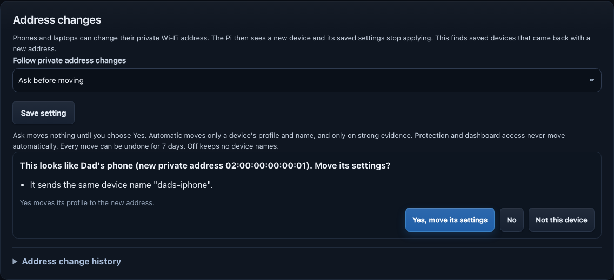
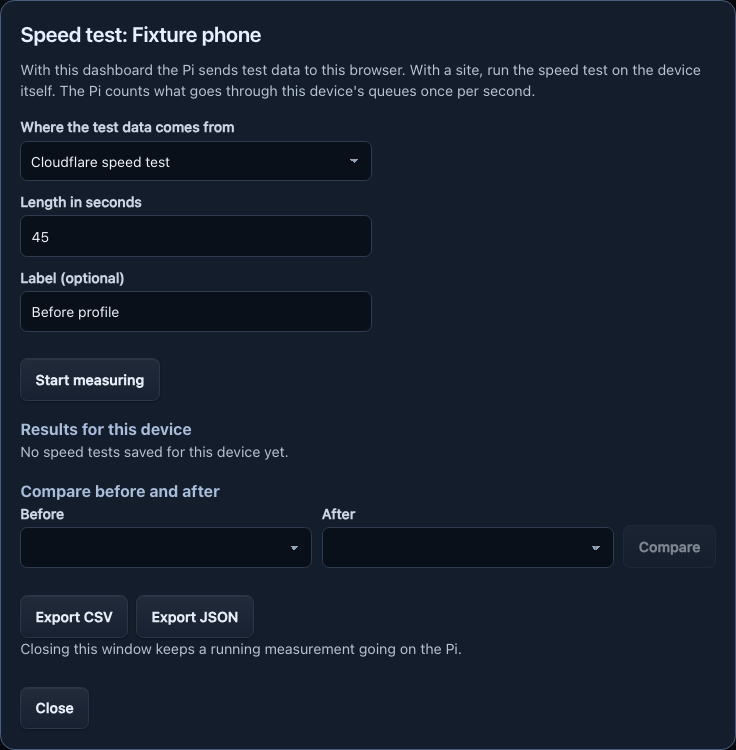

# JitterSim

JitterSim helps you test how a phone or laptop behaves when its internet
connection is slow or unreliable. A Raspberry Pi creates a separate test
Wi-Fi so experiments do not change your regular home Wi-Fi.

Use JitterSim only on equipment and networks you own or have permission to
test. It is for experiments, not a replacement for your home router.

## What you can try

- Slow, delay or interrupt a test connection.
- Save different settings for one device or the whole test Wi-Fi, and start a
  single device on its own profile.
- Schedule changes, run a timer or gradually switch between settings.
- Control device, website and service access, with data and time limits.
- Protect a device from every profile. A protected device opens the dashboard
  with the admin token alone and can have ads blocked.
- Review connected devices and traffic while a test runs. The device you browse
  with over the test Wi-Fi is marked **This device**. Measure a device's
  speed before and after a profile, or check its packet loss, delay and jitter
  against the profile.
- Follow a saved device to its new private Wi-Fi address, with Ask, Automatic and Undo.
- Choose whether active profiles resume after a router outage.
- Restore the Pi's test Wi-Fi to its default name with one sidebar button. The page names the network to join again.
- Update the Pi in one step from the dashboard or a terminal with a signed
  release, a recovery copy and an automatic health check.

## Screenshots

  
  

The Address changes card lets you review a saved device's new private Wi-Fi
address before moving its settings. The speed-test window lets you choose a
site and test length before starting a test on the device.

  
  

*Sample data only; no real phone, Pi or home network is shown.*

## Get started on a Raspberry Pi

Use Raspberry Pi OS with NetworkManager 1.50 or newer, Ethernet connected to
your router and a Wi-Fi radio that supports access-point mode. Create a
`jittersim` account with Raspberry Pi Imager. See the
[Pi deployment guide](deploy/raspberry-pi/README.md#install-or-update) for
signed-release installation, network checks and recovery instructions.

After installation, verify the SHA-256 fingerprint printed by the installer
before trusting the dashboard certificate. Then open
`https://netlab.local:8080` or an IP address covered by the certificate. The
generated admin token is on the Pi in `/etc/jittersim/control.env`.

## Update the Pi

Open **Updates** on the dashboard, choose **Check for updates** and then the
install button, which names the new release. Or run `sudo jittersim update` on
the Pi, or `jittersim remote update now` from a Mac. Each one installs only a
release signed by a key the Pi trusts, keeps a recovery copy and restores it
when the health check fails. The Pi needs a read-only GitHub token once
(`sudo jittersim update set-token`) before it can look for releases. See
[Update the Pi](docs/user-guide.md#update-the-pi) and
[Signed releases](deploy/raspberry-pi/README.md#signed-releases).

## More information

The [feature and operations guide](docs/user-guide.md) explains the dashboard,
network behavior, [known limits](docs/user-guide.md#known-limits) and local
developer setup. See the [changelog](CHANGELOG.md) for what changed, the
[release guide](docs/releases/README.md) for publishing a release, the
[roadmap](ROADMAP.md) for future work, and the
[documentation index](docs/README.md) for the rest of the guides.
