# Dashboard UI overhaul: proposal (2026-10-09)

Status: the visual refresh in this proposal is implemented in the same pull request. The framework prototype is an experiment under `experiments/ui-react-prototype/` and is not wired into the product.

## Recommendation in three sentences

Stay on the vanilla stack for the product and make it look polished through design tokens, one refresh stylesheet and inline SVG icons: this is what the pull request does. Do not migrate to React: it costs about 224 KB of runtime on a page that must work offline from a wheel, and the real cost is rewriting 9,500 lines of `dashboard.js` that 30 browser journeys pin by id and text. If the owner still wants components later, Preact (6 KB gzip with the Devices prototype) is the only framework that fits, and it should come one page at a time behind the same ids.

## What the dashboard is today

- One page assembled by Python from `dashboard.html`, `dashboard.css`, `workflows.css`, `access.css`, `phone.css` and several scripts. It is served inline under a Content-Security-Policy that allows only hashed inline script and style, `connect-src 'self'` and `img-src 'self' data:`.
- Assembled size: 756 KB raw, 160 KB gzip (JS 423 KB raw, CSS 94 KB raw after this change).
- 40 baseline captures (nine pages and sign-in, 375 px and 1440 px, two colour preferences) come from `python -m tests.browser.gui_baseline`.
- The page is dark only on purpose. `tests/unit/test_dashboard_phone_layout.py::test_dark_only` and `tests/browser/journeys.py` pin `color-scheme: dark` even when the browser asks for light. The brief assumed a light theme exists. It does not.
- Colours were 240 hex literals spread over four CSS files, with no spacing or type scale. That is the main reason the page looks choppy: the same grey appears in nine slightly different blues, cards, rows and chips use different radii and borders, body text and notes jump between sizes, and buttons carry a one rem top margin that makes rows uneven.

## Findings from the research

What the products people compare against do, in the parts that carry over to a small single-network tool:

- Tailscale admin console: a formal design system, status indicators in the same place on every row, quiet neutral surfaces and one accent colour. Its iOS app was redesigned to share the console's colours and type, so one token set drives every surface.
- Pi-hole and AdGuard Home: both run on a Raspberry Pi like this one. Pi-hole is known for its charts. AdGuard Home put its effort into a clean layout, grouped settings and expandable rows. Pi-hole v6 moved its web interface into the server binary, which shows the same trend: fewer moving parts on the Pi.
- Linear and Vercel style: layered near-black surfaces with one-pixel borders instead of heavy shadows, a short type scale, small uppercase labels, subtle motion under 300 ms, a focus ring that is always visible.
- Grafana: dark panels for charts in every theme, so series colours keep their contrast. The refresh keeps the chart plates dark for the same reason.

Framework options judged against this project's constraints (no CDN, wheel packaging, hashed CSP, build on a Mac only, one maintainer, test impact):

| Option | Runtime size (gzip) | Build step | Fit |
| --- | --- | --- | --- |
| Vanilla with tokens (chosen) | 0 | none | Fits every constraint. Tests keep working. |
| Preact (10.29) | about 4 KB runtime. Measured prototype page: 6.4 KB | esbuild, on the Mac only | Fits if bundled into one file that the server hashes. Compatible with React habits. |
| Lit | about 5 KB | optional | Web components fight the existing global CSS and the id-based tests (shadow DOM hides ids). Poor fit. |
| Svelte 5 | 2 to 10 KB, compiled | Vite or esbuild plugin | Smallest output, but a new language to maintain and a compile step for every page. |
| React 19 | measured prototype page: 69.7 KB | esbuild or Vite | Works, but 11 times the Preact size for the same page. No benefit for a single owner here. |

Measured with `experiments/ui-react-prototype` (`npm run sizes`): the same Devices page, minified, gzip level 9, runtime included: Preact 6,374 bytes, React 19 69,658 bytes. The shared CSS is 17.6 KB gzip in both. These numbers are for one page. A full port would add its own code on top of the runtime.

Search results on bundle sizes were mostly blog posts. Treat the Preact and Svelte figures from the web as secondary. The table uses the measured numbers where they exist.

## What a framework migration would need

The product constraint is the test suite and the ids, not the framework. A migration needs these steps in this order:

1. Pick Preact. Add `package.json`, a lockfile and an esbuild script under a new `frontend/` folder. Commit the built file into `src/jittersim/api/` so the wheel build and the Pi never need Node.
2. Teach `dashboard.py` and the server to assemble and hash the built bundle like any other inline script. The CSP stays as it is.
3. Port one page at a time (Devices first), keeping every id, label and text that the journeys query. Keep the polling and the fetch helpers in plain modules. A page and its tests move together.
4. Run the full gate on every page: pytest, the journeys, every module in `wifi-recovery.yml`, axe and the baseline. Expect about 30 journeys to need selector care and a few unit tests that read HTML or CSS source to move to the built output.
5. Other agents edit `dashboard.js` for features today. A migration has to freeze those files page by page or the merges will conflict for weeks.

Honest cost: several days of work for the first three pages, weeks for all nine, with no change visible to users that the token refresh does not already give.

## Existing libraries considered

Rule from the owner: check for a mature free library before writing a component. What was checked, what was chosen and why. Licences and sizes below are what was verified on 2026-10-09. Where a figure could not be confirmed it says so.

| Option | Verdict | Reason |
| --- | --- | --- |
| Lucide icons (ISC, `lucide-static` 1.54.0) | Adopted | Mature, maintained, free for a private repo. Ten drawings are copied into `refresh.css` as inline SVG masks. No runtime, no request, works with `img-src 'self' data:`. The licence text is in `docs/third-party-notices.md`. This replaced icons I had drawn by hand. |
| Preact (MIT) | Prototype only | 6.4 KB gzip for the Devices page. Fits the constraints but a migration is the cost, not the library. See above. |
| Open Props | Not adopted | It is a set of generic CSS custom properties (sizes, shadows, easings, palettes). The dashboard needs named roles (card, inset row, success text) that Open Props does not provide, so the roles would still be hand-written. I did not confirm its licence or size. Worth another look if the spacing and shadow scales grow. |
| Pico.css (MIT per its README) | Not adopted | Restyles bare HTML elements. The dashboard is built from about 400 custom classes and strict id-based tests, so adopting it means overriding most of it. It would also turn the incremental refresh into a rewrite. |
| Tailwind standalone CLI | Not adopted | Needs a build step and utility classes in the markup. Most markup is built in `dashboard.js` template strings that other work is editing. The strict CSP is fine (generated static CSS) but the migration is the cost. |
| Alpine.js | Not adopted | Its default build needs `unsafe-eval`. A CSP build exists but limits expressions to component methods. Gain is small because the page logic is already plain JS. |
| htmx | Not adopted | Built for server-rendered HTML fragments. The Pi serves JSON, so it would mean changing the server for no visual gain. |
| Lit, Svelte | Not adopted | See the framework table. Shadow DOM hides ids from the tests (Lit). A compile step per page (Svelte). |

## Visual direction (implemented)

Palette (dark, slightly less saturated than before, layered by lightness):

| Role | Token | Value |
| --- | --- | --- |
| Page | `--bg-page` | `#090d14` |
| Sidebar | `--bg-sidebar` | `#0c121b` |
| Card | `--bg-card` | `#0f1621` |
| Inset row | `--bg-inset` | `#0d1520` |
| Field | `--bg-field` | `#0a1019` |
| Hairline | `--bd-card` / `--bd-subtle` | `#1d2838` / `#202b3c` |
| Text strong / body / muted | `--tx-strong` / `--tx` / `--tx-muted` | `#f1f5fb` / `#cbd5e3` / `#93a3b8` |
| Accent | `--accent` | `#5aa9ff` |
| Success / warning / danger text | `--ok-text` / `--warn-text` / `--bad-text` | `#6fe0b0` / `#f2c46d` / `#ffa3a3` |

All of it lives in the first `:root` block of `dashboard.css`. About 80 named roles replace 240 hex literals. Changing one value changes the whole page.

Type: system font stack (no web font, so nothing to fetch) with a mono stack for ids. Scale: 0.69, 0.75, 0.81, 0.94, 1.125 and 1.31 rem. Section titles 1.31 rem at weight 650 with slightly tight tracking. Small uppercase labels for table headers and metrics. Tabular numbers for counts.

Spacing and shape: a 0.25 rem step scale (`--sp-1` to `--sp-6`), radii 0.45, 0.6 and 0.9 rem for controls, rows and cards, hairline borders, one soft shadow for cards and one for pop-overs.

Components: cards with a faint top sheen. Buttons with a top highlight, press feedback and a stronger primary. Fields with a clear hover, an accent border and a soft halo on focus. Status badges with a dot. A dashed, centred empty state. Tables with quiet uppercase headers and row hover. A sidebar with a logo mark, one icon per page and an accent bar on the current page.

Motion: cards rise in over 280 ms when a page opens, toasts slide in, the pending badge pulses. Only position moves, never opacity: a fade made the axe contrast check read blended colours and report 19 false contrast failures, so it was dropped. Under `prefers-reduced-motion: reduce` every animation and transition is cut to nothing.

Icons: Lucide drawings (ISC) inlined as CSS masks (`url("data:image/svg+xml,...")`) so no markup changed, nothing is fetched and `img-src 'self' data:` already allows it. The colour follows the text colour.

Accessibility: the focus ring is a two pixel outline plus a halo on every control. Text roles keep at least 4.5 to 1 contrast on their surfaces (a unit test checks the Impact card). Touch targets are untouched. Landmark names are untouched.

## Before and after

Screenshots from `python -m tests.browser.gui_baseline` with fixture data, dark theme. Before on the left, after on the right in each row of the table.

| Page | Before | After |
| --- | --- | --- |
| Devices, 1440 px | 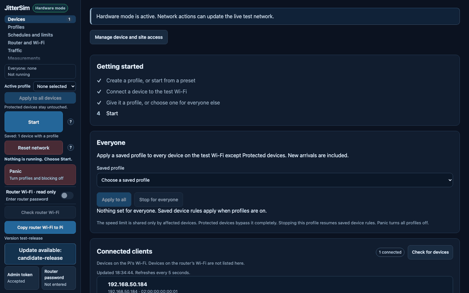 | 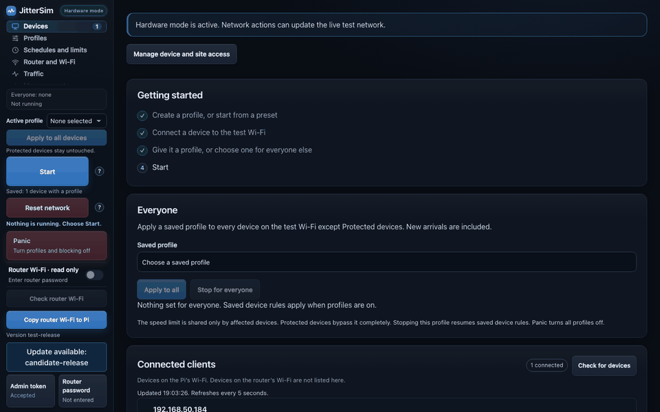 |
| Profiles, 1440 px | 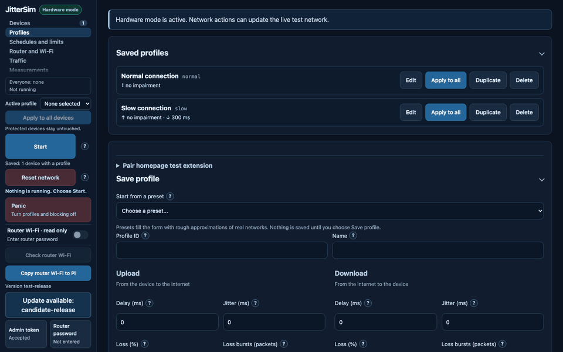 | 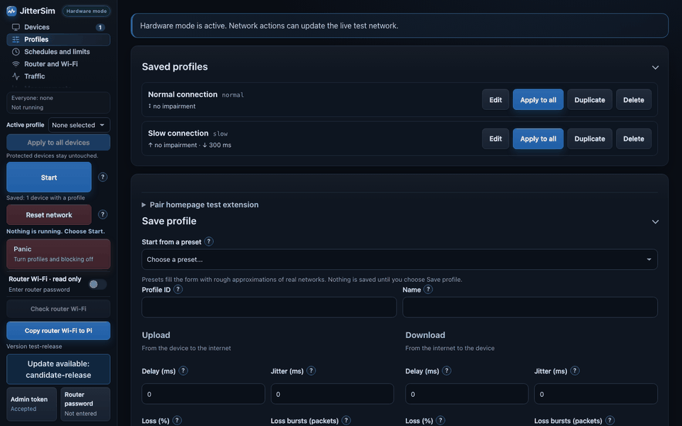 |
| Traffic, 1440 px | 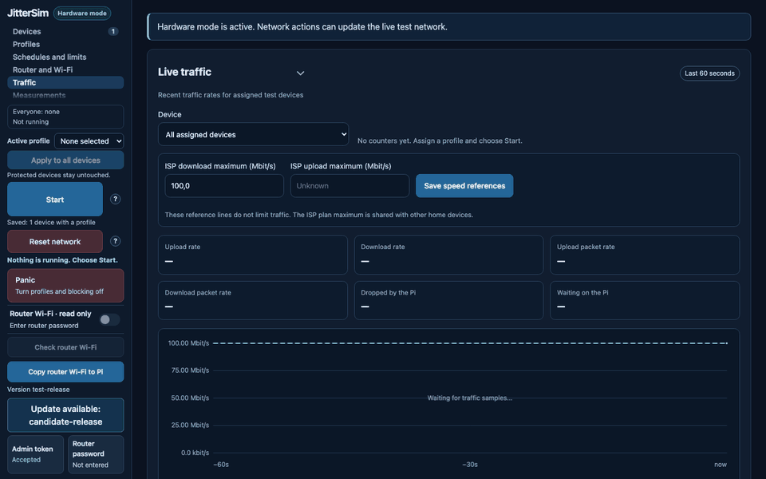 | 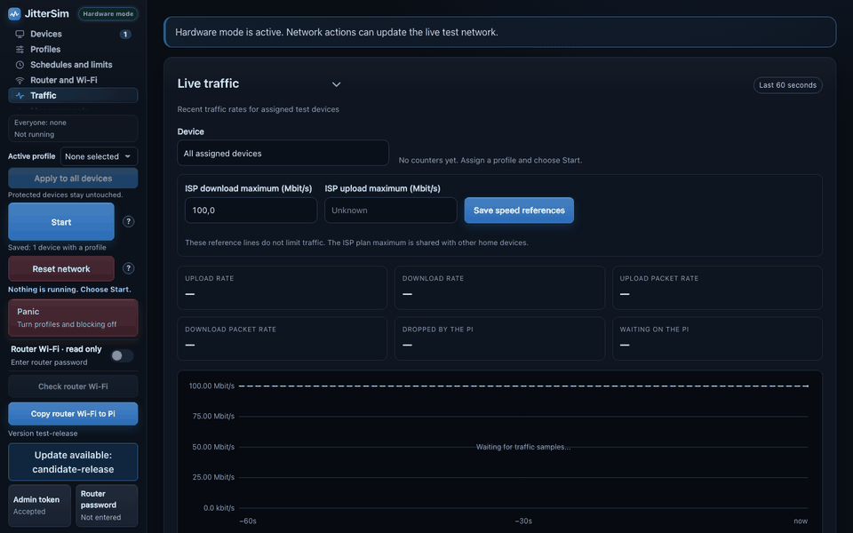 |
| Router and Wi-Fi, 1440 px | 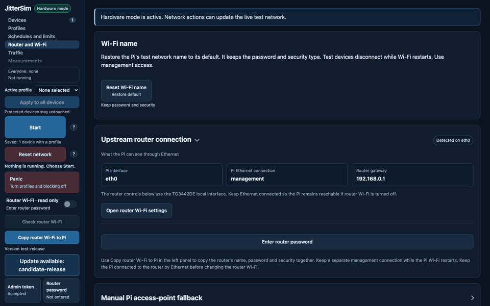 | 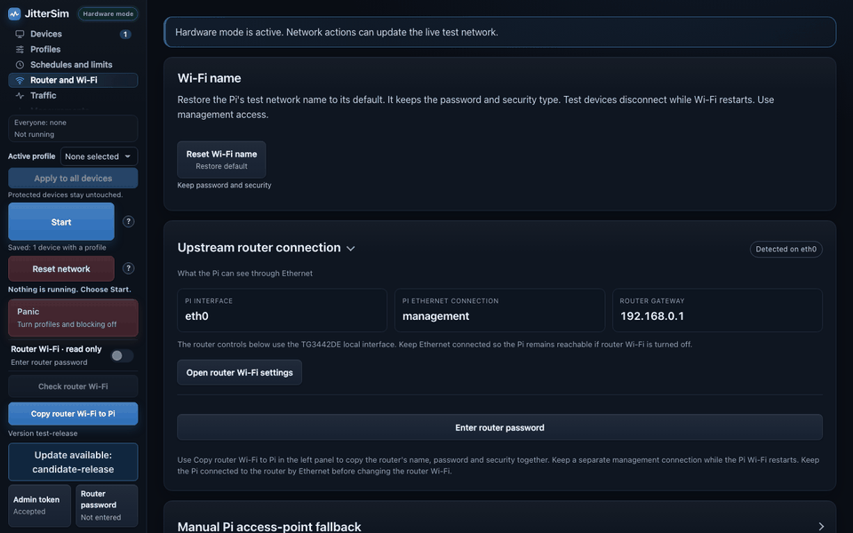 |
| Devices, 375 px | 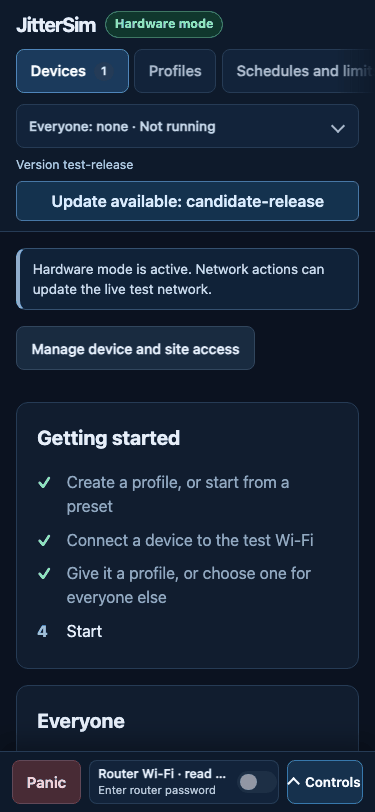 | 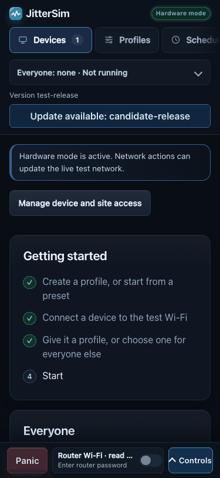 |
| Profiles, 375 px | 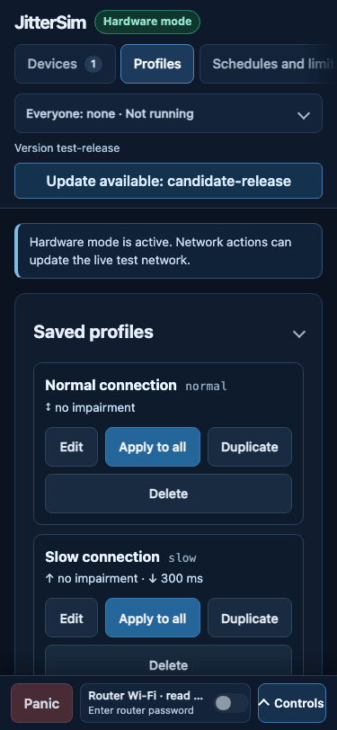 | 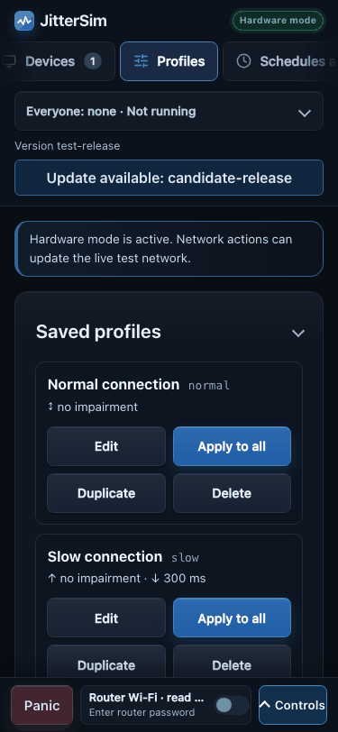 |
| Schedules, 375 px | 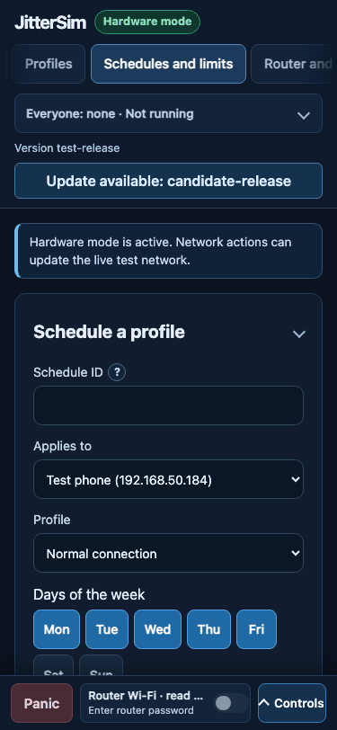 | 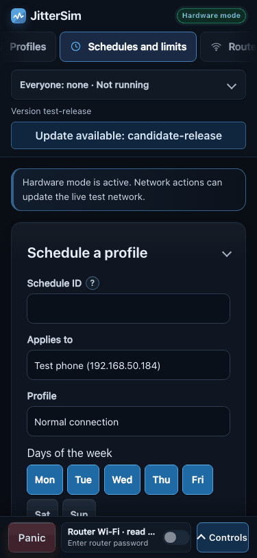 |

## Not done and why

- No light theme. The existing tests pin dark only. The tokens make a light palette a short override block (about 80 values in one `@media (prefers-color-scheme: light)` rule plus a lighter chart plate), but it needs the two pinned tests changed. This is the owner's decision, see below.
- No skeleton loaders. The script shows status text while it loads, and adding placeholder markup would touch `dashboard.js`, which other work is changing. The pending badge pulse and the dashed empty state are the safe part.
- No change to sizes, layout and phone behaviour. The refresh changes paint and rhythm, not the structure that the phone tests measure.

## Decisions for the owner

1. Light theme: yes or no. If yes, change `test_dark_only` and the colour-scheme line in `journeys.py` and add a light token block. Roughly half a day.
2. Framework: stay vanilla (recommended) or start a Preact migration from the Devices page. The prototype shows the cost and the size, nothing more.
3. Brand: the sidebar logo mark (not from a library) is a placeholder pulse line on the accent colour. Replace it if there is a real logo.
