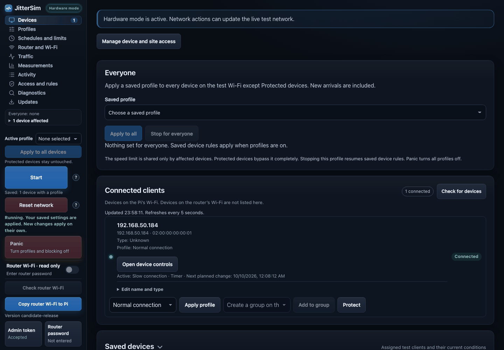
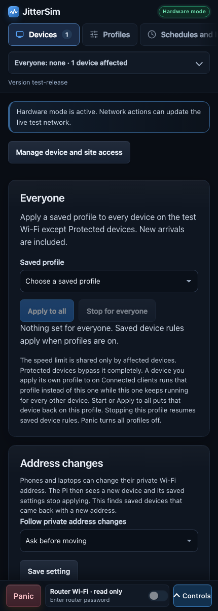
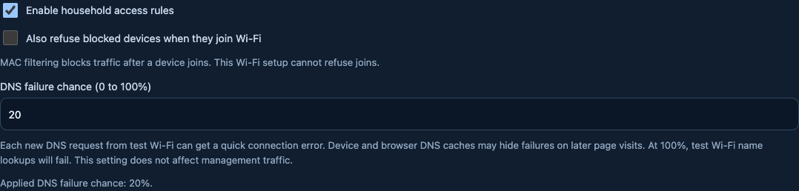
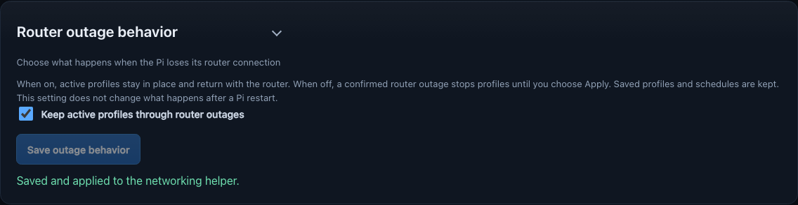
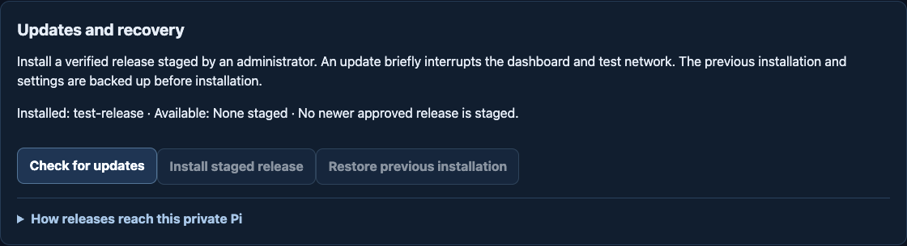

# JitterSim feature and operations guide

This guide contains the detailed feature, network and developer notes.
For a short overview and Pi quick start, see the [project README](../README.md).
For installation and recovery, see the [Pi deployment guide](../deploy/raspberry-pi/README.md).

JitterSim helps you see how a phone or laptop behaves when its internet
connection is slow or unreliable. A Raspberry Pi creates a separate test
Wi-Fi. You can try changes on that Wi-Fi without changing your regular home
Wi-Fi.

Use JitterSim only on equipment and networks that you own or have permission
to test. It is for experiments, not a replacement for your home router.

Stable versions use tested signed packages with owner approval. See the
[release guide](../docs/releases/README.md) for candidate builds and publication.

## See it in action

<div align="center">
  
  
</div>

*Screenshots use sample data. No real phone, Pi or home network is shown.*

The dashboard lets you choose a test profile for a device, start a timer,
then see which profile is active. Press **Normal access** to stop profiles,
schedules and household blocking when you are done.

### Make some website lookups fail



Choose a chance from 0% to 100% that a new website name lookup from the test
Wi-Fi gets a quick connection error. At 0%, this effect is off. This first
version shows a site-connection error. It does not send you to the site's home
page or to a random website. Saved browser and device lookups can delay when
you see the effect.

### Choose what happens if the router goes offline



With this option on, active profiles return when the router connection comes
back. With it off, a confirmed router outage stops active profiles until you
choose **Start**. Saved profiles and schedules stay
available. This first version covers router outages only. Pi restart behavior
is unchanged.

### Update the Pi



Open **Updates** and choose **Check for updates**. When a read-only GitHub
token is saved on the Pi, the Pi downloads the newest release, checks its
signature and stages it. The page then names the release and who signed it,
and **Recovery copy** says whether a copy of the previous installation is kept.
When the Pi reports release notes for the staged release, a **Release notes**
section shows them. Choose the install button, which names the staged release
(for example **Install v1.1.0**). It reads **Install update** and stays off
while nothing can be installed. The confirmation names the signer. The previous
installation and its settings are backed up first. If the Pi's health check
fails after installation, it tries to restore that backup by itself. The sidebar
shows **Update available** while a release is staged. Checking every day and
installing automatically are both off until you turn them on.

On the Pi the same is one command: `sudo jittersim update` (add `--yes` to skip
the question or `--offline` to skip GitHub). It checks GitHub, shows the new
version and its notes, asks, installs and reports success only when the
install completed and passed the health check. From the Mac use `jittersim remote update now`. `jittersim version`
prints the version the Pi runs.

The Pi stages and installs only releases signed by a release signing key you
trust on it and newer than the one it runs. The admin token can only install
the release already staged. See
[Signed releases](../deploy/raspberry-pi/README.md#signed-releases) for the
one-time setup (trusted key and GitHub token), passwordless deploys and what a
leaked token or a stolen key can do. To publish a new release see
[Releasing JitterSim](../docs/releasing.md) and the [changelog](../CHANGELOG.md).

## What you can try

- Slow down a test device, add delays, drop some data or simulate short
  interruptions.
- Change a device's profile for a set time or use schedules and scenarios to
  switch profiles automatically.
- Block selected devices or named websites on the test Wi-Fi.
- Set data or time limits and compare connection measurements.
- Use the browser proxy to test different profiles on selected secure
  websites.
- Choose whether profiles stop or resume after a router outage.
- Restore the Pi Wi-Fi name to its default (`TestNet`) from the dashboard or
  terminal.

**Reset network** stops active profile effects while leaving saved settings
and household access rules in place. **Normal access** also turns off device
and website blocking. Both keep the test Wi-Fi separated from your home
devices. If the dashboard is unavailable, connect to the Pi over SSH and run
`sudo jittersim normal-access`. The
[runbook for an unreachable dashboard](../docs/runbooks/dashboard-unreachable.md)
lists what to check first.

Site rules include subdomains. A VPN, encrypted DNS or direct internet
connection can bypass network-only filtering. Existing connections or cached
website lookups can continue until they expire. Site blocking is not a
replacement for parental controls. Refusing a device's Wi-Fi connection needs
a supported access point and Pi hardware testing.

## Use the terminal

You can check the Pi and change the new settings over SSH without opening the
dashboard:

```sh
sudo jittersim status
sudo jittersim access status
sudo jittersim access dns-failure show
sudo jittersim persistence show
sudo jittersim update
sudo jittersim update check
sudo jittersim diagnostics
sudo jittersim logs dns --lines 80
```

To change a setting, use `sudo jittersim access dns-failure set 15` or
`sudo jittersim persistence set on`. The DNS setting is saved separately from
applying access rules, so run `sudo jittersim access apply` after changing it.
Run `sudo jittersim --help` for the command list. More examples are in the
[Pi installation and recovery guide](../deploy/raspberry-pi/README.md).

Use **Reset Wi-Fi name** on Router and Wi-Fi or run `sudo jittersim wifi reset` on the Pi.
It restores the default name `TestNet` and keeps the current password. Confirming the reset
restarts test Wi-Fi, so its clients need to reconnect. Add `--yes` when running
without a prompt. This command needs the local helper but not the dashboard or
its settings database.

### Use the terminal on your Mac

These commands run on your **Mac** (or any computer that reaches the dashboard)
and talk to the Pi's HTTPS dashboard with the same checks as the browser. They
need no `sudo` and no SSH. Install the command once from a checkout:

```sh
python3 -m venv ~/.jittersim-cli
~/.jittersim-cli/bin/pip install .
echo 'export PATH="$HOME/.jittersim-cli/bin:$PATH"' >> ~/.zshrc
```

Open a new terminal afterwards so `jittersim` is found.

Copy `/etc/jittersim/ca/ca.crt` from the Pi through a connection you
already trust and compare its SHA-256 fingerprint with the one the installer
printed. Then save the address and the certificate path once:

```sh
jittersim connect --url https://192.168.0.17:8080 --ca-cert ~/jittersim-ca.crt
```

`connect` checks the dashboard certificate against that authority and saves
only the address and the certificate path in `~/.config/jittersim/cli.json`.
The certificate file decides where the token goes, so it must belong to you and
must not be writable by others. If the check fails the command says why: an
unknown certificate (compare the fingerprint), an address the certificate does
not cover (for example after the Pi got a new address: use its covered name or
renew the leaf through the verified update route) or an expired certificate.

Every other command asks for the **admin token** with a hidden prompt each time.
The token is never saved and never accepted as an argument. Scripts may set
`JITTERSIM_ADMIN_TOKEN` instead: other programs that can read your environment
can then read it too. Plain HTTP, redirects and addresses with a user name,
path or query are refused. Names from the dashboard are shown without terminal
control characters.

| Command (on the Mac) | What it does |
| --- | --- |
| `jittersim status` | The release the Pi runs (and a staged one), whether JitterSim is running, the general profile and each affected connected device with its profile. Protected devices are never listed. |
| `jittersim profiles list` | The saved profiles with a one-line summary. The general profile is marked. |
| `jittersim profiles apply-all PROFILE_ID` | Makes that profile the general profile for every connected device. Protected devices stay untouched. |
| `jittersim profiles stop-all` | Stops the general profile. Saved device rules resume. |
| `jittersim traffic` | The names each test device looked up, grouped by app or site like **Traffic discovery**. Add `--scan` to sample first, `--expand` for every name, `--blocked` for blocked names only or `--device NAME_OR_IP`. |
| `jittersim traffic block DOMAIN` | Adds a name to the global block list. While household access rules are on the names under it are blocked too. `traffic unblock DOMAIN` removes the exact name. Both say so when nothing had to change. |
| `jittersim wifi show` | The router's own Wi-Fi name, read live from the router. It also asks for the router admin password with a hidden prompt. Add `--password` to show the Wi-Fi password too. |
| `jittersim impact` | The **Impact** check: two samples of the Pi's queues `--wait` seconds apart (10 by default, at most 50) judged with the dashboard's rules. The verdicts name the time it measured such as "in the last 10 seconds". |

The terminal commands call the profile for **Everyone** the general profile.

Add `--json` to any of them for machine-readable output (a failure is then
`{"error": ..., "exit_code": ...}` on standard output) or `--help` for details.
On the Pi itself `sudo jittersim status` still shows the local helper status
and `sudo jittersim wifi reset` still runs there.

For this appliance deploy only a signed release from the verified official
`main` after its required checks are complete. This is the deployment policy,
not a guarantee provided by an arbitrary `--ref` value. To put that release on
the Pi from the Mac run
`deploy/raspberry-pi/deploy-from-mac.sh` in a checkout. It runs on the Mac and
needs git, ssh-keygen, ssh, scp, curl, tar, shasum and Python 3. It builds the
release archive of a commit, signs it with your release signing key and
installs it through the verified update service. It shows the
release the Pi now runs. Use `--stage-only` to upload without installing.
When using SSH the Pi asks for its `sudo` password in your terminal unless
passwordless staging is on (see
[Signed releases](../deploy/raspberry-pi/README.md#signed-releases)). Deploying needs a
connection to the Pi's router network or its own test Wi-Fi. The command uses
the trusted HTTPS dashboard on the test Wi-Fi and when SSH cannot answer.
See
[Deploy from a Mac](../deploy/raspberry-pi/README.md#deploy-from-a-mac).

## Features

### Profiles and network effects

- Delay, jitter, packet loss, bandwidth limits, packet reordering, duplication
  and corruption. Downloads get all of them. Uploads never get reordering or
  duplication, and their corruption runs before the Pi forwards: see
  [Upload safety for the router](#upload-safety-for-the-router).
- Separate upload and download controls where the network supports them.
- Per-device profile assignment from the dashboard.
- A saved profiles list on the **Profiles** page with **Edit** and **Apply to
  all** beside every profile. Every profile field has a **?** help icon.
- A safe configuration-only mode for building plans without changing traffic.
- Hardware mode with a protected Pi helper that applies and resets plans.
- Browser service profiles that shape selected HTTPS hostnames on a managed Mac
  browser while other proxied sites keep the device's ordinary profile.
- Service lists that give chosen apps and sites their own profile on every
  affected device with no per-device setup.

### Schedules, timers and randomness

- Multiple daily time windows with click-to-select days and overnight ranges.
- One-shot timers that activate a profile for a chosen duration.
- Progression sessions that move from a starting profile to an ending profile
  over time, after a DNS-query target or after a device-data target, then
  recover automatically.
- Relative variation such as `200 ms ± 30%` or a custom minimum and maximum.
- Relative variation can use steps of 0.01%. Applied packet percentages
  stay whole. A base of 6% with 7% variation rounds to a fixed 6%. Use a
  custom range for 0% to 13%.
- Previews use the same rounding and limits as the selected values. Delay
  and jitter use whole milliseconds. Bandwidth uses whole kbit/s.
- Ordinary profiles use their base values until the first reroll. Setting
  **Reroll every** to 0 keeps those base values and preserves saved ranges.
- Random feature enablement, reroll timing and short connection outages.
- Fresh patterns per target or repeatable saved seeds with bounded history.
- Inline help in the dashboard for the variation settings.
- Daily counts of kept and removed website choices for scheduled random
  profile rerolls, with up to 30 days stored on the Pi. These counts show the
  generated profile choices, not site visits or confirmed network blocks.

### Devices and website rules

- Connected-device discovery with current Wi-Fi connection status, IP and MAC
  addresses, signal strength and DHCP names when available.
- Device type suggestions from local DHCP names plus editable names and types
  stored on the Pi. Categories are phone, tablet, laptop, desktop, TV or
  console, other and unknown. Type labels never change traffic rules.
- Click-to-select devices and assign profiles from the dashboard.
- Device groups that apply one profile override to several devices at once.
- Add connected clients to groups without entering their IP or MAC address.
- A saved list of **Protected devices** that no profile or profile quota affects.
- A live upload and download graph with packet rates for assigned devices.
- MAC address allowlists and denylists.
- A global blocked-site list.
- Profile-specific website lists that allow selected services while blocking
  the rest.
- Per-device website rules that can change as a progression session advances.
- Device names in every list instead of bare IP addresses.
- Local DNS observations with query counts and plain-language labels. Names that
  belong to one app collapse into a group. Buttons add observed domains to a
  profile or the global block list and show when a name is already blocked.
- Protected devices stay out of traffic monitoring. They are greyed out and never appear
  in traffic discovery or in the impact check.
- Optional DNS ad blocking for each protected device without saved browsing history.
- An impact check in Diagnostics that shows packet loss and speed limits
  actually happening to each device.
- A **Test speed** button on each connected device that measures its real speed
  through the Pi while it runs a public speed test, keeps the results and compares
  a result before a profile with one after it.
- A **Check connection** button on each connected device that sends a short burst
  of pings from the Pi and compares the loss, round trip, jitter, duplicates and
  order with the profile that applies to the device.

### Data quotas

- Per-device byte quotas that switch to a fallback profile after the limit is
  reached.
- Shared group byte quotas that add the traffic from all group members. A
  per-device quota takes priority when both are configured.
- Per-service quotas that group several observed domains for one service such
  as a streaming platform.
- Service quota weights from `0.1×` to `10×`, so a service can consume its
  quota faster or slower than its actual byte count.
- Service time quotas that allow active traffic for a set number of minutes or
  hours inside a timer window such as 5 hours in a 12-hour session.
- Time quotas can start, stop and reset from the dashboard and can reset after
  an interval or at several times each day.
- Manual, timed or daily quota resets.
- Usage bars, current usage, reset actions and editable limits in the dashboard.
- Quota changes that preserve the configured rule while resetting its counter.

Groups are limited to one group per device. Service and timed service quotas
remain device-specific, while shared group quotas measure combined device
bytes.

### Pi and router controls

The left sidebar, visible on every page, shows **Router Wi-Fi · read only**.
On a phone it sits in the bar at the bottom of the screen next to **Panic**.
It shows the router's confirmed On or Off state and the last check time. The
switch is always disabled. JitterSim does not turn the router's Wi-Fi on or
off. The Pi's helper refuses router Wi-Fi changes before it contacts the
router. Use the router's own button or settings page for that.
Enter the router admin password then choose **Check router Wi-Fi** for a
fresh status. Remembering the password or opening the page does not start
automatic router checks. The Pi spaces router sign-ins apart: after a right
password a check can run again 15 seconds later and after a wrong one 30
seconds later. A check pressed too soon is refused and the router is not
contacted. An unavailable status says so instead of guessing.
Keep the Pi connected by Ethernet when copying router Wi-Fi.

Under the switch **Copy router Wi-Fi to Pi** applies the router's Wi-Fi name,
password and security together to the Pi's test network. Its progress and
result appear beside the button on every page. Without a router password the
button opens the **Router password** panel. A rejected password disables the
button until the password changes. Test clients disconnect while the Pi Wi-Fi
restarts so keep a separate management connection. The copy action keeps the
Wi-Fi password out of the page and clipboard.

The sidebar also shows a short status block once the admin token is accepted.
Its first line starts with **Everyone:** and names the profile for Everyone with
`active`, `paused` or `saved, not applied`. It says `Everyone: none` when no
profile is chosen. The next line says how many connected devices are affected
right now and opens a list with the profile each one gets. Protected devices are
never listed. A line starting with **Service lists:** names the enabled lists.
The device line says `Profiles off` after Reset or Panic and `Not running`
before the first start. After a device-only start it lists only the devices
that run and shows the profile for Everyone as paused.

**Copy router Wi-Fi to Pi** checks the router's security before copying its
name and password. The confirmation shows the source band and security type.
JitterSim copies personal WPA, WPA2, WPA3 and mixed modes when the Pi can
verify that mode. Older WPA needs a weak-security warning and confirmation.
Unknown modes, open networks, WEP and enterprise Wi-Fi are rejected. An
unsupported Pi mode restores the previous Wi-Fi settings instead of choosing
another mode. The router itself is not changed by copying.

A device asking for a WPA, WPA2 or WPA3 password needs the Wi-Fi password for
that network. After copying router Wi-Fi this is the router's Wi-Fi password.
It is different from the router administration password and dashboard token.

Use **Reset Wi-Fi name** on the **Router and Wi-Fi** page or run
`sudo jittersim wifi reset` on the Pi to restore the default name `TestNet`.
Both keep the current password and security type. The action restarts Wi-Fi and disconnects
test clients. Add `--yes` to confirm without an interactive prompt. The console
works with the dashboard stopped and needs the local helper.

Fresh installations and new manual Wi-Fi settings use WPA3 with AES.
Upgrades preserve the existing security type. Runtime changes inspect the
active radio before reporting success. Mixed-mode support depends on the
Pi's software and Wi-Fi radio. Saved settings alone do not prove support.

Copying the router's Wi-Fi name can make the debugging computer join the Pi.
Use saved dashboard access below to keep control while testing. SSH still
requires the router network or a local Pi terminal.

#### The Pi Wi-Fi name after a reboot

After a copy that worked the Pi returns to the router's Wi-Fi name at every
boot, for example from `JitterSim-Recovery`. Before that it reads the Wi-Fi
names on the air once: first the list the Pi already has, then at most one
fresh scan. That scan is active (the Pi asks nearby Wi-Fis to answer, as a
phone does), but it never signs in to or changes the router, and the boot
waits for it about 20 seconds at most.

- When the router's own Wi-Fi already sends the router name, the Pi keeps
  `JitterSim-Recovery` for this boot, or takes it when it had the router name.
  Two Wi-Fis with one name on two subnets make phones and laptops switch
  between them, which looks like "connected but no internet". Household
  devices then use the router Wi-Fi, also the ones that were on the Pi under
  the router name, and test devices join `JitterSim-Recovery` with the same
  password. A neighbour, a guest network or a mesh repeater with exactly the
  router name has the same effect.
- When the look finds nothing, cannot run or the radio is busy, the boot does
  what it did before and uses the router name. A problem with the look never
  keeps the test Wi-Fi off. At a cold boot the Pi first waits a few seconds for
  its Wi-Fi radio to be ready, so the look can run.
- To use the router name again, switch the router Wi-Fi off and reboot the Pi,
  or run `sudo /opt/jittersim/.venv/bin/python -m jittersim.networking.wifi_follow router`
  to use it now anyway.

`sudo /opt/jittersim/.venv/bin/python -m jittersim.networking.wifi_follow status`
shows what the last boot saw and why it chose the name (`boot_decision` and
`boot_scan`, for example `router-on-air` and `seen`). The dashboard does not
show this yet.

The test Wi-Fi also does not start when the Pi's Ethernet address is inside
`192.168.50.0/24`, the Pi Wi-Fi's own subnet, because the Pi could not route
both. `systemctl status jittersim-ap` and the `uplink` line of `status` say so.
Change the router's LAN to another subnet, for example `192.168.0.0/24`, and
reboot the Pi. The check runs only when the Wi-Fi starts.

### Dashboard access from Pi Wi-Fi

On the Pi Wi-Fi open `https://netlab.local:8080`, the same address that works
on the router's Wi-Fi. The Pi announces this neutral name on the test Wi-Fi
itself, so it needs no router and no Ethernet cable. Change it with
`sudo jittersim dashboard-name set <name>.local` (see the Pi deployment guide).
You can also use an address covered by the certificate, for example
`https://192.168.50.1:8080`. A browser keeps its remembered sign-in per
address, so use the one address on both networks to sign in once. Choose **Admin token** then **Check
token** and **Allow this device**. This registers the actual requesting
computer. The dashboard lists saved devices and supports removal.

The first visit shows a certificate warning. After signing in, **Trust this Pi**
offers the Pi's local certificate as a `.crt` file and as an Apple profile with
three short steps for a Mac and an iPhone. Once installed, the warning is gone.
The certificate permits local `.local` and `home.arpa` names and the configured
network address ranges. Check its fingerprint against the installer output
before installing it on your device.

Only dashboard traffic avoids simulated loss and client blocks. Your ordinary
internet traffic still follows its profile. The separate **Protected devices**
list continues to cover broader profile exemptions. SSH and access to private
router devices remain restricted.

The limited sign-in page is reachable before registration. Private data,
downloads and controls require the token plus saved access on Pi Wi-Fi.
The hardware address is not a password. Anyone holding the admin token may
register their own device. Changed private Wi-Fi addresses need registration
again. If current device observations cannot be verified, reconnect and retry.

From your **Mac**, with JitterSim installed and a trusted copy of the Pi's
public authority certificate (`/etc/jittersim/ca/ca.crt`):

```sh
jittersim dashboard-access allow-self --url https://192.168.0.17:8080 \
  --ca-cert ~/jittersim-ca.crt --name 'My Mac'
```

The hidden prompt asks for the **JitterSim admin token**. Certificate checks
stay enabled. No `sudo` or Linux firewall command is needed on the Mac. Copy
`/etc/jittersim/ca/ca.crt` through a previously trusted Pi connection, or download it from **Trust this Pi**.
Do not copy the private key or accept an unverified replacement certificate.

From a **Pi terminal**, root recovery works while the dashboard is stopped:

```sh
sudo jittersim dashboard-access add 02:00:00:00:00:01 --name 'My Mac'
sudo jittersim dashboard-access list
sudo jittersim dashboard-access remove 02:00:00:00:00:01
sudo jittersim dashboard-access status
```

Use your device's current Wi-Fi hardware address. Here `sudo` asks for the
Pi account password. The helper must be running. Entries survive restart,
reboot and upgrades in root-owned `/etc/jittersim/dashboard-access.json`.
Include this file in private Pi backups. Dashboard SQLite downloads do not
contain it. The file contains device addresses, optional names and addition
times. It contains no tokens or traffic history and removal deletes the entry.
Saved access remains usable while the Pi refreshes a connected device's
address. Adding access requires a freshly confirmed device address.

An initial upgrade of an older release still needs wireless access through
the real router or a local Pi terminal because its firewall predates sign-in.
Rollback restores that older access behavior while retaining the saved file.

- The Pi's Ethernet network name and router gateway in the dashboard.
- Rename the Pi test access point and change its password locally.
- Enter the Vodafone TG3442DE admin password. The Pi does not save it. The
  browser keeps it in the page only, or for 24 hours if you choose Remember.
- Check and copy the router's Wi-Fi name, password and security to the Pi.
- Read the router's primary Wi-Fi status. This is read only. Turning the router
  Wi-Fi on or off is done with the router's own button or page.
- A direct link to the Vodafone router page for settings JitterSim cannot
  change.
- A visible status area for the current mode, connected devices, schedules,
  access rules, diagnostics and a short history of admin actions.
- Download a point-in-time backup of settings and local DNS observations.
  Random website-choice analytics stay on the Pi and are left out of downloads.
- Restore the last applied or reset state when the dashboard service restarts.
- Optional private remote dashboard access through Tailscale Serve.

### Browser service profiles

Save a **Browser service profile** with a test device, a profile and one or
more HTTPS hostnames. For example, one assignment can list `linkedin.com`,
`netflix.com`, `google.com`, `microsoft.com` and `youtube.com`. A hostname also
matches its subdomains. Separate assignments can give each service a different
profile. These names are starting points. Add other hostnames actually used by
each service, such as media or sign-in hosts, when you need them covered.

On a Mac connected to the JitterSim test Wi-Fi, set the browser's **HTTPS
proxy** to `192.168.50.1` port `3128`. The proxy uses the requested hostname
for each HTTPS tunnel. Two sites on the same server address can receive
different profiles. Other HTTPS tunnels use that device's ordinary profile.
Traffic from devices outside the test Wi-Fi stays outside JitterSim. Existing
affected proxy tunnels close when a new network plan is applied so the browser
can open them with the current profile. Protected clients keep their tunnels
when another client's profile changes. Removing protection or changing global
access rules can close those tunnels.

This strict hostname selection covers HTTPS connections that the managed
browser sends through the proxy. Native apps, browser traffic that bypasses the
proxy, VPN traffic, plain HTTP, QUIC and connections without a hostname are not
classified by the browser service profile. They can still receive the ordinary
device profile. The test Wi-Fi is IPv4 only. A service may need several
hostnames, so verify the actual requests for your test case. Device traffic
counters include browser proxy tunnels. Existing service byte and time quotas
use observed DNS and address matching for direct traffic and do not count
browser proxy tunnels. See the [Pi guide](../deploy/raspberry-pi/README.md)
for Mac setup and a repeatable isolation check.

One applied plan supports at most 15 combined devices and service rules and
200 browser service hostnames. The dashboard rejects overlapping service
domains on the same device and rejects server IP addresses as service names.

Traffic discovery stores local summaries of DNS names and query counts. Select
several observed names when creating a service quota because one service can
use many domains. Resolved addresses refresh at most once a minute. A service
quota counts matching IPv4 traffic as one service group then applies its
weight. For example, `1.2×` charges 120 MB of quota usage for 100 MB of
matching traffic while `0.8×` charges 80 MB. It does not prove that someone
opened a page.

Time quotas count active matching traffic between counter samples. A long
Netflix stream can therefore use the time allowance even when there are no
new clicks. They are an observed-traffic estimate, not a media player timer,
and only work while the device uses the Pi as its gateway.

Progression DNS mode uses DNS query counts as its signal. It does not count all
packets or measure download bytes. Device-data mode counts IPv4 upload and
download bytes for the selected device, so a long Netflix stream can advance a
progression even when it creates few new DNS queries.

### Service lists

A **Service list** applies a profile to chosen apps and sites on every affected
device. Find it under **Schedules and limits**. Tick services from the catalogue (LinkedIn, Microsoft Teams, ChatGPT,
Claude, Netflix, YouTube and more) and add any extra hostnames then choose the
profile for them. You can keep several lists with a different profile each.

While a list is enabled, traffic from an affected device to its services gets
that profile instead of whatever the device would otherwise get. That
includes no profile at all, a device, group, schedule, timer, progression or
quota profile, a browser service profile and the profile for Everyone. A device with
no profile browses normally until it opens one of the listed services. All
other traffic is untouched. The list applies to upload and download traffic of
any protocol including QUIC. **Protected devices** are never touched. Global MAC and website rules still apply. A random outage or website
list from the device's own profile does not cut a listed service. A device in
a random outage still loses the Pi's DNS and browser proxy so it reaches a
listed service only through addresses it already has.

The profile's packet settings, random variation and outage settings apply while
the dashboard scheduler runs. A service list uses one shared changing pattern.
Browser assignments use their own pattern for each assignment. Active byte and
time quota fallbacks also use changing settings. A service outage temporarily
uses 100% packet loss in that service's queues. Profile website allowlists are
rejected on these service paths because their scope cannot be preserved there.
Global access rules still apply.

All affected devices share one speed limit for each list in the same way the
profile for Everyone shares its limit. Delay, jitter and loss apply to each packet.

### Changing patterns

Under **Randomness, outages and website access**, choose **Repeat saved pattern**
or **Fresh pattern**. Existing profiles keep their saved behaviour. An empty
saved seed continues to mean zero. Clear the seed when choosing a fresh pattern.
Stop then start to choose new seeds. Changing a target's profile settings also
starts a new pattern. Pressing Start again with unchanged active settings keeps
the current pattern.

Outage choices advance independently of packet-setting changes. An outage ends
before the next check interval begins so repeated choices cannot extend it
forever. The dashboard scheduler must remain running to apply these changes.
If it stops unexpectedly, use Reset or Panic through a working management
connection. Independent expiry for future temporary scenarios is still planned.

**Recent pattern choices** shows the latest 100 recorded choices with their
target and seed. History keeps at most 1000 entries per session and 10000 overall
for seven days. It contains selected settings rather than application contents.
Copy a recorded seed into a saved pattern for the same target to repeat its
choices. Packet timing, scheduler delays and application results can differ.

Compatible changes to existing non-duplicating impairment queues preserve their
counters. Changes of target membership, queue type or duplication still replace
the queues. Valid managed-browser tunnels survive unrelated plan publications.
Changes that block their destination or change their selected queue close them.

Before a code downgrade, change fresh profiles back to saved patterns or restore
a compatible private configuration backup. Older releases reject the fresh
pattern setting. Stop profiles and verify normal traffic before replacing code.

Matching is by destination address. A small service on the Pi reads the DNS
answers that leave the Pi towards the test Wi-Fi. When an answer names a listed
hostname or one of its subdomains (or an alias that leads to one) its addresses
join the list within a moment. The Pi also resolves the hostnames of every
enabled list about once a minute for devices that cached an answer earlier.
Addresses stay in a list for six hours after they were last seen and a new plan
starts with the addresses already known. A list holds up to 100 hostnames and
remembers up to 1024 addresses. A client that sends its own fake DNS answers to
the Pi teaches it nothing. The browser proxy also checks the lists first by
exact hostname. Browser tunnels to a listed service are not counted in the
device's data counters because a list belongs to no single device.

A hostname also matches its subdomains and can only be in one enabled list.
A list may hold a name and its own subdomain. Other sites on the same server
address as a listed service get the list's profile too and skip the device's
own outages and website rules the same way. The catalogue is a starting point
so verify a real session and add the hostnames it actually uses. The first
connection to a service that follows the first DNS answer by a few milliseconds
may escape the profile. Encrypted DNS on a client (such as iCloud Private Relay
or DNS over HTTPS), VPNs and fixed server addresses are not covered. One applied
plan supports at most 15 combined devices, service rules and service lists.

### Starting and stopping

**Start** starts JitterSim with everything you saved: device and group profiles
and schedules and limits and service lists and access rules. The button always
reads **Start**. While JitterSim runs the dashboard says so and pressing **Start**
again applies the saved settings again. Changes you save apply on their own
within a few seconds so you do not press the button again. **Reset network** stops the profiles and removes
their rules from the Pi. Household blocking of devices and sites stays on.
**Panic** does the same and turns household blocking off too. Your saved
settings are kept. Choose **Start** to run the profiles again. After Panic turn household blocking back on under Access rules.
Protected devices are never touched.

After **Reset network** you can start one device on its own: choose a profile
beside a connected client and click **Apply profile**. Only that device starts.
The profile for Everyone, other saved devices, everyone else, service lists and
ad blocking stay paused. Apply more clients the same way to add them. The status
line says `Running for N devices only` and **Start** resumes every saved
setting. **Reset network** or **Panic** stops the devices again. After Panic or
a router outage, choose **Start** first.

While a profile for Everyone runs you can also give one device its own profile.
Choose a profile beside the connected client and click **Apply profile**. That
device leaves Everyone and runs the profile you chose. Everyone keeps running for
every other device with the same profile and the same shared limit. The status
line says how many devices run their own profile. **Start**, **Apply to all**,
**Stop for everyone**, **Reset network** and **Panic** end this for every device,
and deleting the device ends it for that device. Nothing paused starts as a side
effect.

The line under the button counts what is saved. The message after a start counts
what JitterSim really started. Access rules also run after a start so a start
with no profiles saved says that they apply. Without the Pi helper the dashboard
says that it needs the helper to run.

**Active profile** above the button names the profile for Everyone that is
active right now. When none is active choose a saved profile in the list. Nothing
changes until you press **Apply to all devices**. While that profile is active
the button reads **Stop**. It works like **Apply to all** and **Stop** on the
Profiles page and protected devices stay untouched.

### On a phone

Up to a width of 768 pixels the dashboard uses a phone layout. The top of the
page shows the name, the mode, every page in one row that scrolls sideways and
one line of status. Tap the status line to open the full status block. A page
link shows the start of that page. **Panic** and the read-only **Router Wi-Fi**
status stay in a bar at the bottom of the screen on every page. **Controls** in that
bar opens a sheet with **Active profile**, **Start**,
**Reset network**, the status and message lines, **Check router Wi-Fi**,
**Copy router Wi-Fi to Pi** and the **Admin token** and **Router password**
buttons. Tap outside the sheet or press
Escape to close it. Buttons, fields and the page links are at least 44 pixels
tall.

### Everyone: one profile for the whole test Wi-Fi

The terminal commands and older notes call this the general profile. Choose a
saved profile under **Everyone** on the **Devices** page then click **Apply to
all**.
It applies immediately to every unprotected device on JitterSim Wi-Fi,
including clients without saved assignments and clients that connect later.
There is no device selection, schedule, duration or usage quota to configure.

The profile's upload and download speed limits are shared only by affected
devices. **Protected devices** bypass those limits completely
and do not consume that shared allowance. They also bypass the profile's delay,
loss, website rules and random outages. Separate global access rules still
apply to all clients.

While the profile for Everyone is active it takes priority over saved device,
group, schedule, timer, progression, browser service and quota profile rules.
Service lists still take priority over it for their services.
Those settings remain saved. Quota charging pauses during this mode. Timers
and schedules keep their original times. The traffic chart shows the shared
limit and combined affected traffic rather than an individual device limit.
Random changes apply to the network together. Their choices are not added to
the per-device random website history.

**Stop for everyone** (or **Stop** in the sidebar) resumes the saved device
rules that are current at that moment. While the network is reset, Stop only
removes the selection and starts nothing. **Panic** or **Reset network** turns
all profiles off while keeping the selection. **Apply to all** or **Start**
resumes it. A restart repeats the last Start or Reset unless a saved change
cleared that record. Then JitterSim is not running until you choose **Start** or
**Reset network**. Protected clients remain protected through reconnects and IP
changes.

### Connected clients and protected devices

Open **Connected clients** after checking the admin token. This panel shows
devices on the Pi's test Wi-Fi. Devices on the router's Wi-Fi are outside this
list. A client needs a verified connection and an IPv4 address before a profile
or group can be assigned.

Choose a profile beside a client then click **Assign profile** or **Apply
profile**. Choose an existing group then click **Add to group**. For a client
without a saved assignment, that group needs a profile (**Profile for this
group**). The **Group devices** form can also select several connected clients.
A client can belong to one group. A device's own profile can be overridden by a
group, schedule, timer, progression or quota. The save message explains the
current override.
**Apply profile** starts the profile for that client at once. While JitterSim
runs, the saved settings are applied again with it. After **Reset network**
only that client starts and everything else stays paused. While a profile for
Everyone runs, that client leaves Everyone and runs its own profile. While
Everyone is saved but not running, or a saved change has not reached the network
yet, **Apply profile** is refused and nothing is saved. Choose **Start**, choose
**Reset network**, or save the choice under **Saved devices** for later. An
**Apply profile** request during Reset or Panic is refused too. If a device-only start fails,
JitterSim resets the Pi and retries that reset when needed.

Click **Protect** to protect a connected client from every profile,
random outage, profile website rule and device or service quota. Its traffic
also stops consuming shared group quotas. Its saved assignments stay in place
and resume when protection is removed. Global MAC and website access rules
still apply. Protection does not grant dashboard or SSH access.

The **Protected devices** list keeps protection when a client disconnects
or changes IP. It supports up to 256 saved Wi-Fi MAC addresses. Use **Add an
offline device** for a device that is not connected. If its private Wi-Fi MAC
changes, add the new address. When protection is configured, unverifiable
clients have their profile rules skipped and the dashboard reports a warning.
If applying a change fails, the dashboard reports that settings were saved
but network protection is not confirmed. Retry **Start** after fixing the
helper error.

### Device names

Every list and menu shows a device by name. JitterSim takes the first name it
has: the name you saved for the device's MAC address then a saved device name
then the name the device announced to the Pi then **Unknown device**. A name
you typed always beats one that a device announces. The IP address stays as
small text under the name. A connected client saved without a name takes its
announced name instead of `Client <ip>`.

### Protected devices and privacy

A device in **Protected devices** stays out of traffic monitoring. Its row says `Traffic
is not monitored` and is greyed out with its profile and group controls
disabled. **Stop protecting** and the name and type editor stay active.

- The DNS scan behind Traffic discovery skips the device's frames before they
  are captured. The Pi also drops any row that belongs to a protected MAC
  address or to an IP address that device uses. Old rows never show.
- Making a device protected deletes the lookups already stored for it.
- The service list watcher skips answers sent to protected devices.
- If protected devices exist and the helper cannot skip them (an older helper)
  the scan refuses to run and asks you to restart the services or reinstall.
- Protection follows the MAC address. A device that randomises its Wi-Fi address
  looks like a new unprotected device until you move it to its new address
  (see Address changes below).

### Address changes

Phones and laptops can use a private Wi-Fi address that changes, for example
after you forget the network or turn private addresses on. The Pi then sees a
new device and the saved device's profile, name or protection stop applying.
The **Address changes** card on the Devices page finds saved devices that came
back with a new private address. The setting **Follow private address changes**
has three choices:

- **Ask** (the default): the card says for example "This looks like Dad's phone
  (new private address ...). Move its settings?" with the evidence in plain
  words. **Yes** moves the profile, the name and, for a protected device, its
  protection after a confirmation. **No** hides it for a day. **Not this
  device** hides it for 90 days. The sidebar shows a line while a suggestion
  waits.
- **Automatic**: moves only the profile and the name, and only on strong
  evidence (the same distinctive device name plus the same IP address or a
  join right after the old address left). A protected device is never moved
  automatically. At most one automatic move per device in 10 minutes and three
  a day. Nothing moves automatically while the network is stopped.
- **Off**: looks for nothing and deletes the stored device names. Your No and
  Not this device answers and the pairs seen together stay, so turning it on
  again does not bring back a suggestion you already refused.

The Pi compares the DHCP device name, a confirmed IP address, the time the old
address was last seen and the saved name. It suggests a move only when exactly
one saved device fits one new address. Two addresses that the Pi saw online at
the same time are not matched for 30 days. The Pi only sees this while it
looks (the scheduler runs or the dashboard is open), so it is a safeguard, not a
guarantee. A saved dashboard access grant never moves from
this card: open the dashboard on that device and use the move under Dashboard
access. Every move is listed under **Address change history** with **Undo** for
7 days, and in the activity log. Data limits, groups, website rules and
schedules belong to the saved device, so they follow it.

Privacy, what is stored where:

- Sightings: the last DHCP device name, IP address and time seen, only for
  addresses of saved devices, for at most 30 days after they were last seen.
  Off deletes them.
- Pairs seen together and your dismissals: addresses only, 30 and 90 days.
- Address change history: the addresses, the saved name and which rules
  matched, never the device name the phone sent, for 90 days.
- Activity log and test session reports: one line per move with the saved name
  only, no address and no device name from the phone. None of this is in the settings export, import or version
history. The database backup is a copy of the whole database and includes it.
Keeping a fixed address on the device (Private Wi-Fi address set to Fixed, or
Use device MAC on Android) avoids the problem altogether.

### Optional ad blocking

Each saved entry in **Protected devices** has a **Block ads** switch.
It starts off and works independently from profiles and quotas. The saved
choice follows the Wi-Fi MAC address even when the device disconnects.
Removing protection also removes its ad-blocking choice. Adding it again
starts with the switch off.

Blocking checks requested domain names against an advertising list. It
does not save query logs, per-device counts or browsing history. Ordinary
traffic discovery still excludes the device. A small DNS answer cache is
held in memory so repeated lookups do not need another upstream request.

The first version filters DNS sent to the Pi on JitterSim Wi-Fi and checks
new connections through the managed browser proxy. Expect fewer ads.
Encrypted DNS, VPNs, direct IP connections, existing browser connections
and cached DNS answers can bypass filtering. Ads that share a domain with
useful content cannot be blocked separately. DNS aliases can also hide an
advertising destination from the requested-name check.

Open **Ad-blocking options** to allow domains for broken sites. An allowed
domain includes its subdomains and applies to all devices whose switch is
on. Existing global access rules still apply. **Update ad list** requests
an update. Otherwise the service refreshes the list daily while blocking
is enabled. Failed updates retain the last valid list. Downloads come from
the fixed [StevenBlack hosts list](https://github.com/StevenBlack/hosts).
The publisher lists the contributing sources and their licenses.

The dashboard separates the saved choice from whether blocking is active.
If the DNS blocker dies or its controller stops responding, temporary
routing expires within five seconds and normal DNS rules resume. A failed
initial download leaves normal DNS available. **Reset network** and
**Panic** pause blocking while keeping the saved switches. **Start**
resumes it. Explicitly enabling a switch also resumes
blocking. Turning off a switch keeps profile protection.
Restoring earlier settings preserves a later Panic stop.

### Traffic discovery

**Traffic discovery** is on the **Traffic** page. Press the scan button and
it summarises the DNS names that devices on the test Wi-Fi looked up. A row
shows what a name is for then the technical name in monospace below it. The
labels are app or system or tracker or smart-home or content delivery network.
A name that the table does not know shows its registered domain such as
`immobilienscout24.de`. A content delivery or tracker or unknown name can show
a **seen with** hint that names the app the same device used a moment before.
That hint is a guess from timing and says so. **What is this?** opens a web
search for the name in a new tab. The Pi never contacts an outside service for
this and nothing leaves it until you click.

Names that belong to one app collapse into one row per device such as
ImmoScout24 or Netflix. The row shows the number of names and the total
queries and how many names are blocked. Open it to see the names and their
buttons. A group opened stays open when the page refreshes.

- **Block globally** on a name that is already blocked turns into **Unblock**
  and shows a **Blocked** badge. **Add to profile** reads **Already in** and the
  profile name when the name is in the selected profile's website list.
- While household access rules are on a blocked name also blocks every name
  under it: the Pi's filtered DNS refuses `www.example.com` once `example.com`
  is blocked. The badge and **Unblock** belong to the exact name that was
  blocked. **Unblock** removes it and the names under it resolve again unless
  one of them is listed on its own. With
  household access rules off only the addresses of each listed name are blocked
  while JitterSim runs.
- **Add all to profile** adds every name of a group to the profile chosen on the
  device card. **Block all** blocks every name. It reads **Block remaining**
  when some are blocked and **Unblock all** when all are. One call changes the
  whole group or nothing. A call takes at most 64 names and a block list or a
  profile website list holds 100 names.
- A group of system or content delivery names has no **Block all** because one
  click could cut the device off the internet. Block single names instead.
  **Unblock blocked names** removes blocks from such a group.
- **Add to profile** switches a profile to **Allow only listed domains** and
  lists only that name when the profile was not an allow-list already. Every
  other site stops working for devices that use it. The page asks you to
  confirm first and says so. **Add all to profile** asks the same. A profile
  that already is an allow-list adds the names without a question.

A block or profile change from this card is saved at once. It applies on its
own while JitterSim is running. After Reset or Panic choose **Start**. After
Panic also turn household blocking back on.

### Impact check

The **Impact** card at the top of **Diagnostics** shows what the Pi's queues
really do to each device. It reads the kernel's counters for the last minute
and refreshes every five seconds while the card is visible. A row shows the
device name and direction then what is set and what happened:

- Loss: `set 5% · actual 4.7% (31 of 660 packets dropped)`.
- Speed: `set 2 Mbit/s · using 727 kbit/s · peak 2 Mbit/s · cap reached`. The
  rate is judged for each five second interval and a backlog that is waiting
  at a sample also counts as capped. A burst that drains between two samples
  can still be missed. A capped queue also shows `Queue wait now: about 320 ms`.
- Delay and jitter and reordering and duplication and corruption show what is set
  and say **not measured** because the counters cannot see them. Upload rows
  show the profile's values even where upload reordering, duplication or
  corruption is not applied (see
  [Upload safety for the router](#upload-safety-for-the-router)).
- A verdict in plain words: `Affected in the last minute` or `No traffic in the
  last minute` or `Too few packets to judge` or `No drops or cap hit seen` or
  `Effect not measured here`.

The profile for Everyone and service list and quota queues appear with their own names.
Protected devices are listed on one muted line and never get a row. Applying a
plan restarts the history. A busy helper keeps the rows and shows `Update
paused`. Counters describe packets and drops. They cannot prove how much delay
a device saw. An older helper makes the card ask for an update.

### Device speed test

**Test speed** on a connected device in **Devices** compares the device's speed
before and after a profile. The Pi cannot run a speed test as the phone, so:

1. Choose the speed test site (Cloudflare by default, or LibreSpeed), a length
   (45 seconds by default, 15 to 90) and an optional label, then **Start measuring**.
2. On the device, open the link or scan the QR code and run the test there.
3. The Pi reads the device's queue counters once per second (the counters the
   Impact check uses) and saves download and upload speed: average while busy,
   median, 90th percentile, peak, bytes and drops. It also sends one ping per
   second from the Pi to the device for the round trip and loss over the test
   Wi-Fi. For a device with its own profile that round trip includes the
   profile's download delay and the waiting the running speed test causes. With
   **Same as everyone** or **Everyone else** the Pi's own ping does not pass the
   shared queue, so the result calls it an unshaped Wi-Fi round trip and it does
   not include the profile's delay. A device that blocks ping shows `No answer`.
4. **Finish now** saves early, **Cancel test** saves nothing, and closing the
   window keeps the measurement running. A new apply during the window ends it
   and marks the result `changed`.

Each result keeps the time, the device's MAC address and name, the profile that
really applied (a schedule, timer, scenario or group profile is named as such)
and its values, the label and the numbers you type in from the device's own
speed test page. Results are part of the configuration backup and of the CSV and
JSON exports, so share those files with care. **Compare**
shows the change in each number between two results and whether the speed
matches the profile's cap (`Matches the cap`, `Faster than the cap`, `Slower
than the cap`, `No speed limit set`). **Export CSV** and **Export JSON** download
the device's results without any token or password. **Delete** on a result asks
in the page first (**Delete result** or **Cancel**) and cannot be undone. The Pi
keeps the newest 50 results per device and 500 in total.

Limits:

- The Pi only has a counter for a device while a profile applies to it. A
  device with no profile is `Not measured on the Pi`: type in the numbers the
  speed test page showed. For a measured baseline without limits, save a
  profile with nothing set (for example `No limits`), apply it and test, then
  apply the real profile and test again.
- With **Same as everyone** or **Everyone else** the counters are shared with
  other devices and the result says so.
- Protected devices cannot be tested: they are never shaped and their traffic
  is not measured.
- The device must be connected to the test Wi-Fi. The Pi checks this first and
  pings the address the device has now. While the Wi-Fi connection status is
  unknown the button stays off. If the Pi cannot read its counters it asks you
  to try again. If most reads fail during a test the result is saved as `fault`.
- A test starts only when the queues the Pi reads carry the same numbers as the
  applied profile: delay, jitter, loss and its burst length, reordering,
  duplication, corruption and the speed cap. While a change is being applied they
  differ, and Start asks you to try again in a moment.
- A service rule or service list sends some traffic through other queues. The
  result then says it covers the ordinary queue only and does not judge the cap:
  compare the numbers typed in from the device's speed test page.
- At most two tests run at once, one per device. A dashboard restart drops a
  running test.
- Cloudflare's speed test is free and needs no account. Cloudflare keeps each
  result for its own statistics. JitterSim only links to the page; it does not
  call Cloudflare itself. M-Lab is not offered because it publishes every
  result with the tester's IP address.

The design and the open decisions are in
[implementation-plan-device-speed-test-2026-10-09.md](implementation-plan-device-speed-test-2026-10-09.md).

### Connection check

**Check connection** on a connected device in **Devices** shows whether the profile
applied to the device really takes effect. The Pi sends 100 small ping packets,
10 per second (20 to 300 allowed), to the device and counts what comes back.

1. Wake the device (turn on the screen): a sleeping phone answers slowly.
2. Choose the number of probes and an optional label, then **Start check**. It takes
   about 12 seconds with the default. **Cancel check** saves nothing and closing the
   window keeps the check running.
3. The result gives one verdict and one row per number: the value the profile sets,
   what the Pi measured, and a status in words.

What the numbers are and how they are judged:

| Number | Measured | Judged against |
| --- | --- | --- |
| Packet loss | probes with no answer, with a 95% range | the profile's loss (with the duplication and corruption that change it) plus up to 2 points for a healthy link |
| Round trip delay | median, lowest and 95th percentile | the profile's delay, plus or minus its jitter. Longer than that is shown as extra path delay and never held against the profile |
| Jitter | the average change of the round trip between two probes in a row | what netem gives for the profile's delay and jitter |
| Duplicated answers | probes answered twice | the profile's duplication |
| Answers out of order | answers that came after an answer to a later probe | the profile's reordering, when the delay is long enough for probes to overtake each other |

The verdict is `Matches the profile`, `Less than set` (a number is below what the
profile gives, so the profile is not fully in effect), `More than set` or `Some numbers
are less and some more than set`. A number matches when what the profile sets lies
inside the 95% range of what was measured. It is called less or more only when the
set value lies outside the 99% range. Close to that line the answer is `Close, but not
sure: run it again with more probes`. A small set value cannot be told from a healthy
link: with 100 probes a loss of about 5% or more can, and below about 4% more than
300 probes would be needed. The result says how many probes would tell it apart.

What the check cannot do:

- It checks the **download** side of the profile only. The Pi's probes pass the
  device's download queue, but the device's answers pass no upload queue. Use **Test
  speed** to check the upload and the speed cap. A speed cap is never judged by a
  burst of pings. A profile that changes only the upload side is not judged.
- A device with **Same as everyone** or **Everyone else** is not shaped for the Pi's
  own packets, so the result is `Unshaped Wi-Fi round trip, not comparable with the
  profile`. A device with no profile, a reset network or a protected device shows the
  plain Wi-Fi path as a `Baseline`.
- A service rule, service list or active quota on the device withholds the verdict.
  The numbers stay.
- If the profile, the device's address, its Wi-Fi connection or its protection changes
  during the check, or the Pi cannot confirm at the end that nothing changed, the
  result is saved without a verdict. A set delay over 4.5 seconds and a speed cap
  under 16 kbit/s cannot be measured with pings.
- A device that does not answer ping at all (Windows blocks it by default) is reported
  as `The device did not answer ping`, not as 100% loss. Use **Test speed** or the
  Impact check for it.
- The device must be connected to the test Wi-Fi. At most two measurements run at once
  (speed tests and checks together), one per device. A dashboard restart drops a
  running check.

**Delete** on a saved check asks in the page first (**Delete check** or **Cancel**) and
cannot be undone. **Export CSV** and **Export JSON** download the device's checks without
any token or password. The Pi keeps the newest 50 checks per device and 500 in total. They are part
of the configuration backup.

The design and the open decisions are in
[implementation-plan-connection-check-2026-10-17.md](implementation-plan-connection-check-2026-10-17.md).

## Network layout

```text
Vodafone router ── Ethernet ──> Raspberry Pi
                                  │
                                  ├── JitterSim test Wi-Fi
                                  └── JitterSim dashboard
```

Only devices on the JitterSim test Wi-Fi are affected. Devices that stay on the
router Wi-Fi bypass JitterSim. The test Wi-Fi uses IPv4 sharing. Device rules
and quotas match IPv4, while the browser proxy can connect to public IPv4 or
IPv6 hosts for managed HTTPS traffic.

Any household device can join the JitterSim Wi-Fi without a JitterSim device
record. The DHCP service and ordinary internet forwarding run in
NetworkManager, independently of the dashboard and network helper. A network
plan normally marks devices you add in the dashboard. Other clients use a
normal fair queue. When a profile for Everyone is active every unprotected client
receives it instead. Protected clients keep their normal traffic path.

The connected-device list shows devices currently associated with the Pi's
Wi-Fi. It can show the IP address, signal strength and a DHCP-provided network
name. Type suggestions use only clear words in that name and may be wrong.
Names and types you save stay on the Pi and do not affect traffic. They are
saved against the Wi-Fi MAC address. Apple and Android devices can use private
addresses that change or differ by network, so a saved label may need to be
entered again after an address changes. Offline labels can be removed from the
dashboard. Up to 256 labels are saved. See [Apple's private Wi-Fi address
guide](https://support.apple.com/en-ie/102509) and [Android's MAC
randomization guide](https://source.android.com/docs/core/connect/wifi-mac-randomization-behavior).

**Do not switch the whole house to this AP yet.** The current setup is a
separate IPv4 network behind NAT. Its firewall intentionally blocks access to
the router's private network, which can break wired printers, TVs, NAS and
other local services. It does not offer client IPv6 or normal discovery across
the router boundary. The Pi's Wi-Fi coverage, sustained throughput and client
capacity have not been measured in your house. A Pi outage would disconnect
every device using its Wi-Fi. Keep the router's Wi-Fi available while following
the [household trial](../deploy/raspberry-pi/README.md#household-wi-fi-trial).

The target Pi 3 Model B+ has 1 GB of memory and a 300 Mbps maximum Ethernet
throughput. Its built-in Wi-Fi supports 2.4 GHz and 5 GHz. These specifications
do not establish the speed, coverage or client count the AP will achieve in
your home. Use a good 5 V/2.5 A power supply and set the WLAN country before
the trial. See the [official hardware specifications](https://www.raspberrypi.com/products/raspberry-pi-3-model-b-plus/)
and [wireless setup guide](https://www.raspberrypi.com/documentation/computers/configuration.html).

Test Wi-Fi clients can use the Pi for public internet access but cannot reach
private upstream addresses such as the Vodafone router's `192.168.0.1`. They
reach the dashboard's sign-in page. Private data and controls need the
administrator token and **Allow this device** (see [Dashboard access from Pi
Wi-Fi](#dashboard-access-from-pi-wi-fi)).

Website rules, service quotas and device-data progression are best-effort. VPNs,
encrypted DNS, direct IP access, cached connections and shared hosting can hide
traffic or reduce accuracy. The device must use the Pi as its gateway. Backups
include device details and observed domain names, so keep them private.

The live graph samples the Pi's device counters every two seconds and shows the
latest minute. Solid lines show traffic seen by JitterSim before its queues,
not the speed a device successfully receives. Dashed lines show manually
configured ISP plan limits and the selected device's applied default-queue
bandwidth limits. The initial ISP download reference is 100 Mbit/s and upload
is unset. Edit these values to match the connection. They are graph references
only and do not change network traffic.

The ISP plan limit is shared with other home devices and is not a live measure
of spare bandwidth for JitterSim. Select one device to see its default-queue
limits. Service-specific queues can use different limits, so those profile
lines do not represent every flow from that device. Run a speed test on the
connected device to check its experienced speed.

### Upload safety for the router

The household router must never receive damaged, copied or reordered packets
from the Pi. On 3 and 4 October the Vodafone Station hung twice while a
profile with upload corruption, duplication and reordering ran, and lab
captures showed why that is risky: `netem` on the Pi's Ethernet port changes
whole frames after the Pi built them, so a corrupted frame can carry a wrong
MAC address, EtherType or IP header with a valid Ethernet checksum. See
[the upstream-safe impairment notes](upstream-safe-impairments-2026-10-09.md).

JitterSim therefore shapes uploads like this:

- Delay, jitter, loss and bandwidth limits run on the Ethernet port. They
  never change or copy a frame, and jitter keeps packets in order.
- Corruption runs on a Linux `ifb` device fed from the test Wi-Fi's incoming
  side, before the Pi routes the packet. The Pi drops a packet whose IP header
  was damaged, and a packet whose TCP or UDP checksum was damaged fails at the
  other end like on a real link. A connection's first packet is not corrupted.
- Upload reordering and duplication are not applied. The profile form and the
  Apply message say so. Downloads still get both.
- If the Pi has no `ifb` module or tc `connmark` action, upload corruption is
  left out and the Apply message says so. It never falls back to the old
  placement.
- The Pi's own traffic (ARP, DHCP, DNS, NTP, SSH, the dashboard) never enters a
  shaping queue toward the router. The browser proxy's connections for browser
  service profiles are the one exception: they get delay, jitter, loss and
  rate only. Test Wi-Fi traffic that the Pi's connection
  tracking cannot follow is dropped instead of reaching the router without NAT.

### Router health canary

While hardware control is on, the dashboard checks the household router once a
minute through the Pi's Ethernet port. It reads the router's ARP entry, sends
one ping and asks the router's DNS for one name. It makes no login and changes
nothing. A router that never answers pings or DNS is not counted as down for
that check.

When two checks in a row fail, the Pi's journal gets one record. It says what
failed, which profiles were running, whether upload corruption was active and
how many connections were tracked. Another record follows every ten minutes
while the failure lasts, and one when it ends. Router addresses and device
names are not written. Read the records on the Pi with
`journalctl -t jittersim | grep "router health"`. `jittersim diagnostics
export` lists them as service warnings with their times. The records stay in
the journal across restarts, so an outage leaves evidence from before the
router is power-cycled.

## Dashboard modes

- **Configuration only** saves settings and builds plans without changing live
  traffic.
- **Hardware mode** uses the Pi helper to apply the saved plan.

Choose **Admin token** in the sidebar, enter the token and click **Check token**
to load diagnostics. Dashboard actions show when they start and whether they
worked, without requiring you to scroll to the status area.

For a Vodafone TG3442DE, the dashboard can read the primary Wi-Fi status and
copy the router's Wi-Fi name, password and security to the Pi. It cannot turn
the router's Wi-Fi on or off. The Pi's helper refuses router Wi-Fi changes
before it contacts the router, so use the router's own button or settings page.
The router password is used for one authenticated request and is not saved on
the Pi. Keep the Pi connected by Ethernet while copying router Wi-Fi. If a
router firmware update changes its local web interface, use the direct router
link or the manual Pi access-point form. See the
[Pi deployment guide](../deploy/raspberry-pi/README.md).

For control from another location, join the Pi and laptop to your Tailscale
network and privately serve the dashboard over the Pi's Tailscale name. Keep
the admin token. This does not route the laptop's general internet traffic
through the Pi. The [Pi guide](../deploy/raspberry-pi/README.md#remote-control-with-tailscale)
has setup, access rules, checks and removal steps.

Open the dashboard at one address on every network: `https://netlab.local:8080`.
The Pi announces this neutral name with mDNS on the home router's network and on
the test Wi-Fi. The same address works whether the computer is on the router's
Wi-Fi or on the Pi's test Wi-Fi, so a browser keeps one remembered sign-in
instead of one per network. Bookmark it once. The Pi's Ethernet address and
`192.168.50.1` can be used when covered by the installed certificate if name
lookup fails.

The name is one word followed by `.local` and never contains the product name,
because anyone on the test Wi-Fi can read it before signing in. Only that one
address record is announced on the test Wi-Fi: no host name, no SSH or other
services. To use another name run `sudo jittersim dashboard-name set
bench.local` (and `jittersim dashboard-name` to see the address and whether it
is announced). Browsers keep a remembered sign-in per address, so a new name
needs one fresh sign-in. If another device on the network already uses the
name, `sudo jittersim diagnostics` and the dashboard say so and what to run.

The installer creates a local certificate authority once and prints its SHA-256
fingerprint. An existing valid authority is retained. Verify its fingerprint
through a trusted management connection before installing its public certificate
on your device. The browser's leaf certificate has a different fingerprint. A
DHCP address change on Ethernet is handled by the name itself: the Pi announces
the new address, and the certificate is renewed by the next update. HTTPS
protects the browser-to-Pi connection, but the TG3442DE's own local web
interface still uses HTTP between the Pi and router.

## Set up the Pi

Install only a verified signed release. Follow the [Pi deployment guide](../deploy/raspberry-pi/README.md#install-or-update) for release checks, prerequisites and first sign-in steps.

## Run locally

Run these commands from the repository root. Local mode saves settings and builds plans without changing network traffic.
Needs Python 3.9 or newer. Install the checkout in editable mode so that Python
imports the files you edit:

```sh
python3 -m venv .venv
.venv/bin/pip install -e '.[dev]'
export JITTERSIM_ADMIN_TOKEN='use-a-long-local-token'
.venv/bin/python -m jittersim.api --database ./jittersim.db
```

Open <http://127.0.0.1:8080/>. For Pi setup, remote access and recovery, see
the [deployment guide](../deploy/raspberry-pi/README.md).

## Run checks

Use the editable install from the previous section. A plain `pip install
'.[dev]'` copies the package into the virtual environment, and `python -m
pytest` then tests that copy and not your edits. To see which copy Python uses,
run `.venv/bin/python -c 'import jittersim; print(jittersim.__file__)'`. The
path must point into `src/`.

Run the Python tests and the lint check the way the CI workflows do:

```sh
.venv/bin/python -m pytest -q
.venv/bin/ruff check --select E9,F63,F7,F82,F811 src tests
```

CI runs the Python tests on Python 3.9, 3.11 and 3.13. Some tests start other
programs and skip themselves when the program is missing. Many need Node.js.
Others need `openssl`, `git`, `ssh-keygen` or `curl`. A skipped test is not a
pass. Run `.venv/bin/python -m pytest -q -rs` to list the skips.

The Linux network checks use real firewall and traffic rules in disposable
network namespaces. Run them in a privileged Linux container with:

```sh
tests/kernel/run-in-docker.sh
```

The browser checks exercise the dashboard on desktop and phone-sized screens
(390, 360 and 320 pixels wide, also with wider fonts). They are programs run
with `python -m`, not pytest tests, and they need Playwright and a Chromium
download. The `browser` job in `.github/workflows/tests.yml` installs the built
package in a clean environment so that a dashboard file missing from the
package fails the run:

```sh
pip install . 'playwright==1.63.0'
python -m playwright install --with-deps chromium
python -m tests.browser.journeys
```

The workflows in `.github/workflows` list every check that CI runs for a pull
request: the Python, Linux, browser, homepage reference and GUI baseline jobs.

## More information

- [Pi installation, security, recovery and hardware testing](../deploy/raspberry-pi/README.md)
- Runbooks: [dashboard unreachable](../docs/runbooks/dashboard-unreachable.md),
  [update rollback and recovery copy](../docs/runbooks/update-rollback-and-recovery-copy.md),
  [router outage and Pi-only rollback](../docs/runbooks/router-outage-pi-only-rollback.md),
  [key rotation and trusted keys](../docs/runbooks/key-rotation-and-trusted-keys.md),
  [restore and reimage](../docs/runbooks/restore-and-reimage.md)
- [Measured effects of the profile presets](../docs/measurements-2026-09.md)
- [Product roadmap and known limits](../ROADMAP.md)
- [Index of the documents in `docs/`](../docs/README.md)
